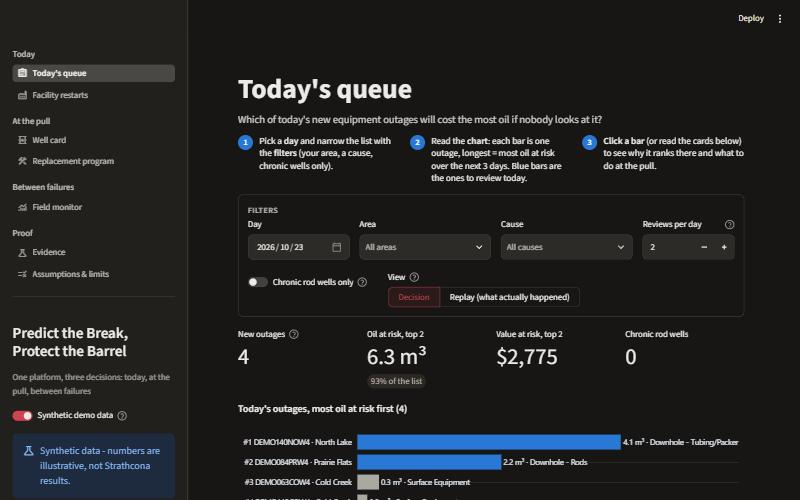
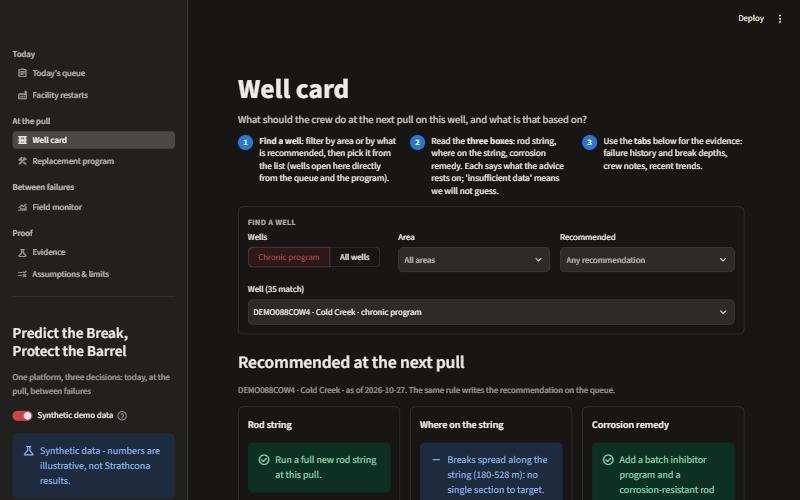
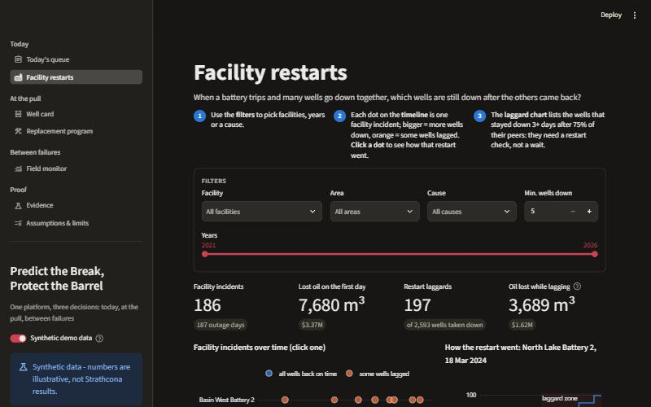
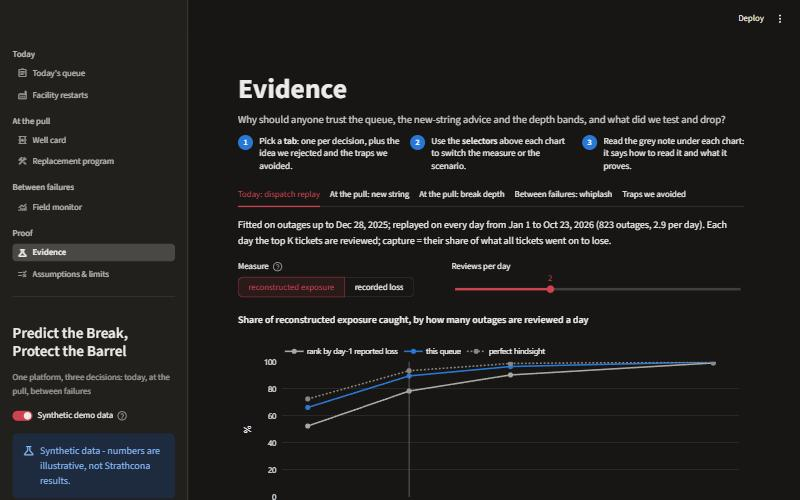
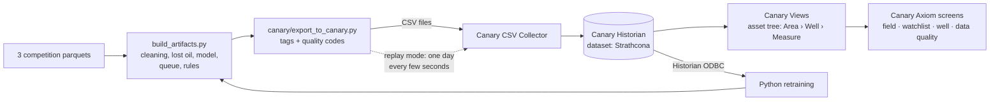

# Predict the Break, Protect the Barrel
### One platform, three decisions: keeping heavy-oil PCP wells running

**DSMLC Datathon 2026 · Chirality Research × Canary Labs · dataset: Strathcona Resources**

**Team:** _Yiming Jin, Ben Bui, Ahron Ramos, Jade Huang_  
**Video (5 min):** _<link>_ · **Slides:** _<link>_

---

## The solution

**Stop repairing the same rod strings over and over.** On any well with **3 or more rod repairs in the last 12
months**, run a **full new rod string at the next pull** instead of another repair.

- **Why:** after a new string, the next rod repair comes at **0.49×** the rate seen after a repair (Cox model on
  chronic wells, 95% CI 0.42–0.58), so about half as many repairs.
- **Where:** **145 chronic wells** today, with 678 rod repairs between them in the last year.
- **Worth:** **C$7.43M net over 2 years** (C$5.89M even at the weakest plausible effect). A new string pays for
  itself on any well that fails more than about **once a year**, and every program well fails at least 3 times.
- **How, at the pull:** if the well's breaks sit inside one ≤150 m band (54 wells), a section plus rod guides
  there may be enough. If corrosion is coded or the crew notes mention pitting, add an inhibitor and a
  corrosion-resistant rod grade.

Two daily habits around it, in the same app:
- **Every morning, review the top 2 outages in Today's queue.** They hold **52%** of the oil at risk, against 43%
  when ranking by the first day's reported loss.
- **After a facility trip, check the wells still down 3 days after 75% of their peers are back.** 73 such cases
  lost 2,377 m³ (about C$1.04M); 50 of them had nothing wrong logged on the well.

All of it runs in one Streamlit app (`streamlit run app/app.py`). The 14-day failure risk, alerts and lost-oil
estimates are loaded into the **Canary Historian**, next to each well's own data.

---

## In one paragraph

Strathcona's 2,240 heavy-oil wells lose about **485,000 barrels a year** to avoidable downtime. Rods, the steel string
that drives the pump from the surface, are the single biggest cause (27%). We built one platform that helps an
operations team with three decisions on three time horizons:

- **Today:** which new outage to look at first.
- **At the pull:** what the crew should do once it is at the well.
- **Between failures:** which wells to watch.

Every number on screen comes from a reproducible pipeline and is backed by a test. The model's risk scores, alerts
and lost-oil estimates are exported to the **Canary Historian** as tags, so they can sit next to the well data in
the operators' own tools.

| Horizon | Question | What we built | Headline result |
|---|---|---|---|
| **Today** | Which newly reported outage do we review first? | **Today's queue**: ranks outages by the oil they will lose over the next 3 days | Reviewing the top 2 a day catches **52%** of the oil at risk, vs 43% when ranking by the day-1 reported loss |
| **Today** | When a battery trips, which wells get left behind? | **Facility restarts**: groups simultaneous outages into one incident and flags slow restarts | **73 wells** stayed down 3+ days after 75% of their peers were back |
| **At the pull** | Patch the rod string again, or replace it? | **Replacement program** + **Well card** | A new string halves the hazard of the next repair (**HR 0.49**). 145 chronic wells: **C$7.43M net over 2 years** |
| **At the pull** | Where on the string, and which remedy? | Break depths mined from crew notes | Same-well breaks repeat within 50 m **2.9×** more often than chance. 54 wells break inside one ≤150 m band |
| **Between failures** | Which running wells fail in the next 2 weeks? | 14-day early-warning model, loaded into Canary as `FailureRisk14d` and `RiskAlert` | Of the 25 wells flagged each day, **29%** fail within 14 days (4.8× the base rate) |
| **Between failures** | Does volatile operation cause rod failures? | "Mechanical whiplash" test | **Rejected** under a rule set before running: no effect once history is controlled for (HR 0.98) |

---

## Contents

1. [Research questions and motivation](#research-questions-and-motivation)
2. [The app](#the-app)
3. [How we used Canary](#how-we-used-canary)
4. [Findings](#findings)
5. [Methods](#methods)
6. [Validation](#validation)
7. [Limitations and next steps](#limitations-and-next-steps)
8. [How to run](#how-to-run)
9. [Repository structure](#repository-structure)
10. [External resources](#external-resources)
11. [AI disclosure](#ai-disclosure)
12. [Data](#data)

---

## Research questions and motivation

1. **Where is oil being lost, and how much of it is avoidable?** Attribute every downtime day across 2,240 producing
   wells (2021 to Oct 2026) to a cause, and value it.
2. **Which outage should an engineer look at first?** Rank newly reported equipment outages so a team that can
   review only a few a day catches the most oil.
3. **On a well that keeps breaking rods, is a whole new string worth it, and where does it break?**
4. **Can we flag wells that will fail in the next 14 days early enough to act?**

**Why it matters.** Heavy-oil wells lift oil with a progressing-cavity pump (PCP) driven by a rod string, and the rods
fail more than any other part. Each failure brings an outage, a service job (median about C$5.9k) and lost oil,
including a decline in the days before the failure that the operator's lost-oil field doesn't count. Field oil
output is **12.7% lower over the last 12 months** than the 12 before, while water cut keeps rising (96.4% → 96.9%).
Cutting avoidable downtime is a lever that doesn't need new wells.

---

## The app

A Streamlit app (`app/app.py`) with one page per decision. Every page follows the same layout:
1. a title that is the page's question, with the one-sentence answer and the next action under it;
2. a closed "How to use this page" panel with the steps and the terms;
3. a filter bar with a reset button;
4. charts, each with a short note on how to read it, and the worked-out arithmetic in panels you can open.

The sidebar holds two controls:
- **Oil price:** one slider (default C$69.71/bbl, the WCS Hardisty price less a 15% field-gate haircut). Every
  dollar figure follows it.
- **Synthetic demo data:** a switch to fake data with the same layout, so the app runs from a clean clone.

| Page | What it answers | Filters |
|---|---|---|
| **Today's queue** | Which new outage loses the most oil if nobody looks? Each bar is one outage; click it for its reason card. Chronic rod wells carry the recommended action for the pull and a link to their Well card. A replay view shows what actually happened next, kept out of the decision view | day, area, cause, chronic only, reviews per day |
| **Facility restarts** | When a battery trips, which wells are still down after their peers came back? A timeline of incidents, the restart curve of each, and the laggard wells | facility, area, cause, minimum wells, years |
| **Well card** | What should the crew do at the next pull on this well? Full string, section at a known depth, corrosion remedy, each with the evidence it rests on; failure timeline; break-depth strip; crew notes; recent trends | area, chronic only, what is recommended |
| **Replacement program** | Which wells get a new string, and does it pay? Ranked value per well, the pay-back curve, and a stress test of every assumption | area, failure cause, minimum repairs, also recommended; stress-test panel |
| **Evidence and data sources** | Queue replay vs hindsight, the Cox model, repeat break depths, crew text vs coded cause, the rejected whiplash test, traps we avoided | measure, reviews per day, model population |
| **Assumptions & limits** | What could make these numbers wrong, and how we would check | decision |

| Today's queue | Well card |
|---|---|
|  |  |
| **Facility restarts** | **Evidence** |
|  |  |

_Screenshots use the synthetic demo data, so no real wells or crew notes appear in the repository._

**How the decisions connect.** The queue, the Well card and the Replacement program all use one decision rule
(`src/rules.py`). Rules 1–3 add up; rule 4 applies to each:
1. **New string:** 3+ rod repairs in the last 365 days and no new string → run a full new string.
2. **Section:** 2+ located breaks, all within a 150 m band → a section and rod guides there may be enough.
3. **Corrosion:** coded Corrosion, or crew notes that mention pitting or corrosion → add an inhibitor and a
   corrosion-resistant rod grade.
4. **Evidence:** every line states its evidence count. With too little evidence the rule says "insufficient data"
   instead of guessing.

---

## How we used Canary

Operators don't work in notebooks. They work in a historian, looking at trends and alarms for each well. So the
pipeline's outputs go **into the Canary Historian as tags**, next to the raw well data, where an operator can trend
them, alarm on them and build screens around them. Canary is how the analysis reaches the operator.



### 1. What we send to the Historian

`canary/export_to_canary.py` writes Canary CSV Collector files, one row per `TagName,Timestamp,Value,Quality`. The
tag path is `Area.Well.Measure`, so Canary Views can build an asset tree automatically. The default export (2026 to
date) is **25,188 tags and 6.65 million values**.

| Measures | Source | Why it's there |
|---|---|---|
| `Oil_m3d`, `Water_m3d`, `Gas_e3m3d`, `HoursOn`, `PumpEfficiency` | daily well data | The well's own trends |
| `PumpRPM`, `RodTorque_ftlb`, `MotorCurrent_A`, `CasingPressure_kPa`, `TubingPressure_kPa` | daily well data | Pump health. A reading identical to the day before is a carried-forward manual entry and is sent with **Uncertain** quality (64), so Canary greys it out on trends |
| `BaselineOil_m3d`, `EstLostOil_m3`, `Downtime`, `LossCategoryCode` | pipeline | Lost oil against the well's own healthy rate, with the cause |
| `FailureRisk14d`, `RiskRank`, `RiskAlert` | early-warning model | Risk of a failure outage within 14 days. Alert 0 = normal, 1 = watch (top 5%), 2 = alarm (top 2%) |
| `FailureEvent`, `RepairCost_CAD` | job records | A pulse on each failure day, shown as markers on trends |
| `Area._Area.*`, `_Field._Total.*` | roll-ups | Oil, lost oil, avoidable lost oil, running wells, wells on watch, wells in alarm, mean risk, per area and field |

Raw readings that are physically impossible (999,999 kPa placeholders, negative volumes) are sent with their raw
value and **Bad** quality (0). The historian keeps the evidence but trends skip them.

### 2. How it is set up in Canary

- **Historian + CSV Collector:** `canary/csv_collector_config.json` points the collector at a watched folder and
  creates the `Strathcona` dataset automatically.
- **Views asset model:** a virtual view splits each tag path on `.`, giving Area › Well › Measure. Every well then
  has the same measure names, so one Axiom template works for all 2,240 producers.
- **Axiom screens:**
  1. **Field overview:** field oil, avoidable lost oil, wells in alarm, and lost oil by area.
  2. **Watchlist:** wells sorted by `RiskRank`, with `RiskAlert` coloured red or amber, oil vs baseline, and pump
     efficiency.
  3. **Well detail** (asset template): oil vs baseline, pump efficiency and failure risk, with failure markers.
     Stale manual readings show greyed out.
  4. **Data quality:** count of Uncertain and Bad values per area, which makes the case for automating the manual
     tags.
- **Alarms:** an event on `RiskAlert >= 2` per well asset where the licence includes Canary's event features;
  otherwise Axiom conditional formatting.
- **Live demo:** `--replay-dir` drops one day's file into the collector folder every few seconds, so tags, roll-ups
  and alarms update on screen as if the data were streaming.
- **Closing the loop:** the model's training features (oil, water, hours on, pump efficiency, pump tags, failure
  history) are all in the historian. A monthly retrain can read them back through **Historian ODBC**.

Step-by-step install, load and screen-building instructions: [canary/README.md](canary/README.md). The organizers'
setup troubleshooting guide (time zone, clean install, licence reset) is in
[canary/Canary_Setup_Troubleshooting_Guide.md](canary/Canary_Setup_Troubleshooting_Guide.md).

### 3. How this meets the Best Use of Canary criteria

| Criterion | What we did |
|---|---|
| **Technical depth** | Historian, CSV Collector, Views (virtual asset model), Axiom (templated screens), events/alarms and Historian ODBC. Canary quality codes carry data-quality information, not just values |
| **Design and usability** | Four screens, one per operator question. One asset template for every well. Alarm colours only where action is needed |
| **Industry relevance** | Real-time monitoring (replay), alarm management (watch/alarm tiers), performance tracking (lost oil vs baseline), operator decision support (watchlist with reasons) |
| **Project integration** | Canary carries the model's outputs (risk, rank, alert, lost oil) to the operator and is the data source for retraining. It is part of the workflow, not an add-on |

### 4. Status

| Piece | Status |
|---|---|
| Canary 26.7 installed and licensed on a team laptop | _Team: confirm_ |
| Exporter, collector config and replay mode | Built and run: 25,188 tags, 6.65M values for 2026 to date |
| Import into the Historian, Views asset tree, Axiom screens, alarms | _Team: confirm and add a screenshot here_ |
| Tags for the newer pages (queue score, chronic flag, pull recommendation, restart laggards) | Next step: the artifacts already exist in `outputs/` and only need adding to the exporter |

---

## Findings

| | |
|---|---|
| **Avoidable lost oil, 2021 to Oct 2026** | **2.69M bbl** (428k m³), about 485k bbl/yr, ≈ C$34M/yr at the default price |
| **Share from equipment failures** | **45%** (rods, pump, tubing). Rods alone are the #1 cause at 27% |
| **Failure events** | 10,408 repair events on producers. **Winter** has the highest failure rate (≈5.4 per running well-year, vs ≈2 for the next areas) |
| **Hidden loss** | Oil already drops in the 1–2 weeks *before* a failure (median 4.5 m³ per event), on top of the outage itself (median 6.4 m³). The reported lost oil doesn't count this |
| **Today: outage queue** (2026 holdout) | Top 2 a day catch **52%** of the next 3 days' oil exposure vs **43%** for ranking by day-1 reported loss; perfect hindsight gets 62% |
| **Today: facility restarts** | 82 synchronized outage days at 14 facilities (76 incidents). 73 wells stayed down 3+ days after 75% of their peers restarted, losing about 2,400 m³ while they waited |
| **At the pull: new string** | 145 chronic wells (3+ rod repairs in a year, no new string) cost C$8.97M all-in last year. A new string halves the hazard of the next repair (Cox **HR 0.49**, 95% CI 0.42–0.58). Break-even is about 1 failure/yr. **C$7.43M net over 2 years**, C$5.89M at the pessimistic end of the CI. 14 wells pay back even when every pessimistic case is stacked |
| **At the pull: where it breaks** | 983 rod breaks located from crew notes (45% of rod failures). Same-well breaks repeat within 50 m **48.6%** of the time vs 16.7% by chance (2.9×, p = 0.001). 54 program wells break inside one ≤150 m band. 13% of "Fatigue" breaks have crew notes mentioning pitting or corrosion |
| **Between failures: early warning** (test 2025–26) | Of the 25 wells on each day's watchlist, **29%** start a failure outage within 14 days (4.8× the 6% base rate). It catches 25% of failures with a median **8 days' warning**, at about 3.3 new alerts a day: 37 failures caught per 100 alerts, vs 5 for a random list |
| **Between failures: whiplash** (rejected) | Day-to-day swings in RPM, torque, current and run hours don't predict rod failures once history is controlled for (Cox HR 0.98 per SD, 0.95–1.01). The small case-crossover edge (OR 1.09) comes from a few outliers |
| **Data quality** | Pressure, torque, motor-current and RPM tags repeat the previous day's value 95–98% of the time (carried-forward manual readings). Automating them is the single biggest data improvement |

---

## Methods

**Cleaning** (`src/data.py`):
- Implausible values (999,999 kPa placeholders, negative volumes, pump efficiency over 300%) are blanked.
- 27 duplicate well-days are removed.
- 32 pump-make spellings are normalised to 8.
- 137 raw downtime codes are grouped into 14 cause categories.
- Details: [DATA_SUMMARY.md](DATA_SUMMARY.md).

**Lost oil** (`src/losses.py`): for each downtime day, lost oil = the well's trailing 30-day median oil rate (fully
running days, past only) × hours down / 24. Economic long-term shut-ins are excluded, because they are a business
decision.

**Outage queue** (`src/dispatch.py`):
- A ticket is a day on which an equipment outage is newly reported.
- Expected extra hours down are estimated per (reason × day-1 hours band) on outages up to Dec 28, 2025, and shrunk
  toward the band average with weight 40 so rare reasons aren't over-trusted.
- That estimate × the well's healthy rate (30-day mean of ≥22-hour days) = oil at risk.
- Tested on every day from Jan 1 to Oct 23, 2026, against ranking by the day-1 reported loss and against perfect
  hindsight.

**Facility restarts** (`src/facility.py`):
- **Sync day:** 5+ wells and 25%+ of the facility's running wells go down on the same day. Days ≤3 apart are one
  incident.
- **Laggard:** a well back 3+ days after 75% of its peers.
- These definitions were fixed before looking at the results.

**Replace vs repair** (`analysis/1/rod_replace_analysis.py`, `src/economics.py`):
- Rod jobs within 3 days on a well are merged into one event.
- A Cox model of time to the next rod repair, stratified by area × year, adjusted for prior repairs, RPM and liquid
  rate, using events from 2022 on so prior history is complete.
- Cost per failure = mean repair job cost (cost > 0, 2023 on) + mean lost oil per repair × price.
- Net value of a new string = repairs per year × (1 − HR) × 2 years × cost per failure − the extra cost of a new
  string (C$14,010).

**Break depths** (`analysis/5/break_depth_mining.py`):
- A depth is read from crew notes only when the wording is unambiguous:
  - "Broken corod @ 247m";
  - a joint number × 7.62 m on stick rods;
  - in job summaries, only a break word together with a metre unit, so pull weights like "free at 15,000 lbs" are
    not read as depths.
- Repeat depth is tested against 1,000 random pairings within the same area.

**Early-warning model** (`src/features.py`, `src/model.py`):
- One row per running well-day. Label = a failure outage starts in the next 1–14 days.
- 34 past-only features: production trends against the well's own baseline, pump efficiency, fluid vs rated pump
  volume, downtime and failure history, pump make, area, well age.
- LightGBM with a strict time split: train Apr 2021–2023, tune on 2024, test on 2025–Oct 2026.
- Watch and alarm thresholds = top 5% and top 2% of 2024 scores.
- TreeSHAP gives the reasons behind each score.

**Mechanical whiplash** (`analysis/whiplash/shock_index.py`, `src/shock.py`):
- A shock index is built from day-to-day changes in RPM, torque, current and run hours, scored against each well's
  own past.
- **Tested two ways:**
  - **Case-crossover:** the 30 days ending 7 days before each rod failure vs the same well 60–180 days earlier.
  - **Cox:** the index added as a covariate to the Cox model above.
- The expected direction and the pass mark were written into the script before the first run.

---

## Validation

- **Time splits everywhere.** The queue is fitted to Dec 2025 and tested on 2026. The model is trained to 2023,
  tuned on 2024 and tested on 2025–26.
- **Checks against operator data.**
  - **Lost oil:** the estimate matches the operator-reported lost oil on 233k downtime days (totals within 1%,
    rank correlation 0.94).
  - **Failure labels:** 91% of logged failures match a repair-job event within ±14 days.
- **Automated tests** (`tests/`, 30 tests):
  - **Reproduction:** the app's default numbers reproduce the analyses (145 wells, 678 repairs, HR 0.485,
    break-even 1.0, C$7.43M / C$5.89M, 983 located breaks, 48.6% vs 16.7%, 54 bands).
  - **Leakage:** queue scores don't change when every row after the decision day is scrambled; the shock index on
    day D ignores day D onward; the whiplash window ends 7 days before each failure; the Cox history uses only
    earlier repairs.
  - **Decision rule:** 0 or 1 located breaks, a band of exactly 150 m, mixed causes, a recent new string.
- **Queue reconstruction:** the queue was rebuilt from the team's written spec. It lands 0.7–2.2 points below the
  originally reported levels (52.7% vs 43.9%) with the same margin over the baseline. That test is marked as an
  expected failure rather than edited.

---

## Limitations and next steps

- **The new-string effect is observational.** Wells that got a new string were chosen by operators. We adjust for
  failure history, rate, RPM, area and year, but a pilot is the real test: randomly assign 70 of the 145 wells a
  new string at the next pull and compare repair rates after 12 months.
- **Break depth covers 45% of rod failures**, with only a 15-row spot check of the parser so far. Hand-label 100
  rows before relying on depth bands.
- **Assumed numbers:** the 40% saving of a section job and the 15% field-gate haircut are assumptions. Lost oil is
  valued as revenue, not margin. All of them are adjustable in the app.
- **Daily data can't see short shocks.** Hourly torque and current from automated tags would let the whiplash
  idea, and the early-warning model, see what daily manual readings miss.
- **The early-warning model leans on failure history.** Production trends add a smaller lift until the pump tags
  are automated.
- **Retraining.** The model is trained once on data to 2024. In production it would retrain monthly from Canary
  through Historian ODBC.

---

## How to run

```powershell
uv venv --python 3.12 .venv; uv pip install --python .venv/Scripts/python.exe -r requirements.txt
```

**From a clean clone (synthetic demo data, no competition data needed):**

```powershell
.venv/Scripts/streamlit.exe run app/app.py
```

The first launch generates fake wells, outages, rod jobs and crew-style notes with the competition's layout, and
builds the demo results (about 30 seconds).

**With the competition data:**

```powershell
.venv/Scripts/python.exe build_artifacts.py --data-dir <folder with the 3 parquets> --out-dir outputs
.venv/Scripts/streamlit.exe run app/app.py
.venv/Scripts/python.exe -m pytest
```

**Into Canary:**

```powershell
.venv/Scripts/python.exe canary/export_to_canary.py --out C:/CanaryImport/Strathcona
.venv/Scripts/python.exe canary/export_to_canary.py --start 2026-08-01 --replay-dir C:/CanaryImport/Strathcona --replay-from 2026-09-15 --seconds 5
```

The first command loads 2026 to date; the second is the live-demo replay. See [canary/README.md](canary/README.md)
for the collector setup.

---

## Repository structure

```
app/app.py, app/ui.py          Streamlit entry point and shared helpers (price, data mode, charts)
app/views/                     Today's queue, Facility restarts, Well card, Replacement program, Evidence, Limits
app/dashboard.py               former Field monitor page (not in the menu; the watchlist lives in Canary)
build_artifacts.py             builds everything the app and Canary read
run_pipeline.py                cleaning, lost oil, early-warning model, queue, facility restarts
src/                           data, features, losses, model, dispatch, facility, rules, economics, shock, demo
analysis/1, 5, whiplash       replace vs repair, break-depth mining, whiplash test
canary/                        Canary CSV Collector export, collector config, setup and screen guide
tests/                         reproduction, leakage and decision-rule tests
screenshots/                   app screenshots (synthetic data)
DATA_SUMMARY.md                data profile (aggregate statistics only)
```

---

## External resources

- Canary Labs, *How to Configure the CSV Collector (v26)*, help-centre article (collector settings and quality
  codes); Canary installation guide supplied by the organizers
- PetroWiki: progressing cavity pumps; the competition Dataset Handbook (PCP, rod string, water cut)
- Price inputs (cited in `analysis/common.py`):
  - WTI from OilPriceAPI (2026-11-19);
  - the WCS Hardisty differential from CalRock via Reuters (2026-11-13);
  - USD/CAD from the Bank of Canada (2026-11-20).
- Methods: Cox proportional hazards and Kaplan-Meier (statsmodels), case-crossover design with conditional logistic
  regression, permutation tests, LightGBM with TreeSHAP
- Libraries: pandas, pyarrow, DuckDB, LightGBM, scikit-learn, statsmodels, SciPy, Streamlit, Plotly

---

## AI disclosure

This project was built with help from **Claude (Anthropic) via Claude Code**, working from the team's direction.

**What Claude wrote most of:**
- the data pipeline and the data profile;
- the Streamlit app, the queue and facility modules, the decision rule and the synthetic-data generator;
- the Canary exporter;
- the whiplash test and the test suite;
- much of the documentation.

**What the team wrote:** the idea analyses in `analysis/` (with AI assistance).

**Review:** the team reviewed the methods and the numbers, and is responsible for every claim. We checked
specifically:
- the time splits;
- the failure-label and lost-oil checks against the operator's records;
- the reproduction tests;
- the leakage tests.

**Data handling:** no well data or crew notes were sent to any external AI service by the app. Crew notes are read
by a regex parser that runs locally.

---

## Data

The competition dataset belongs to Strathcona Resources and is **not** included in this repository, in line with the
competition terms (see `.gitignore`). `outputs/` holds derived results and is also excluded. Screenshots in
`screenshots/` use the synthetic demo data.
