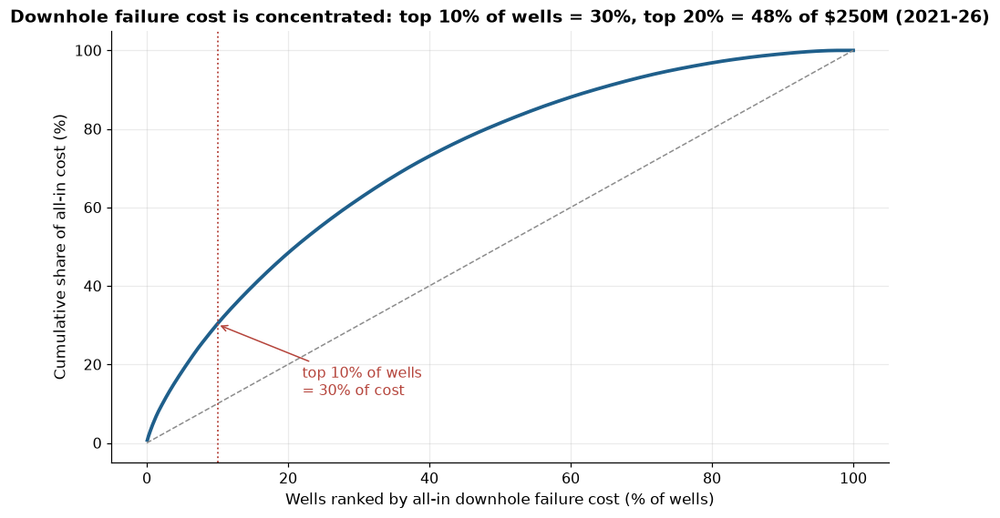
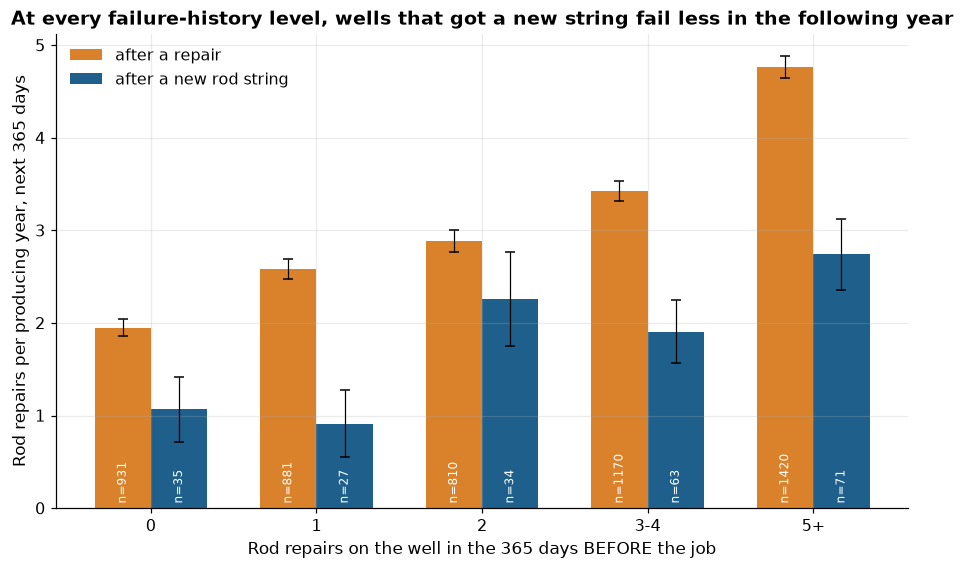
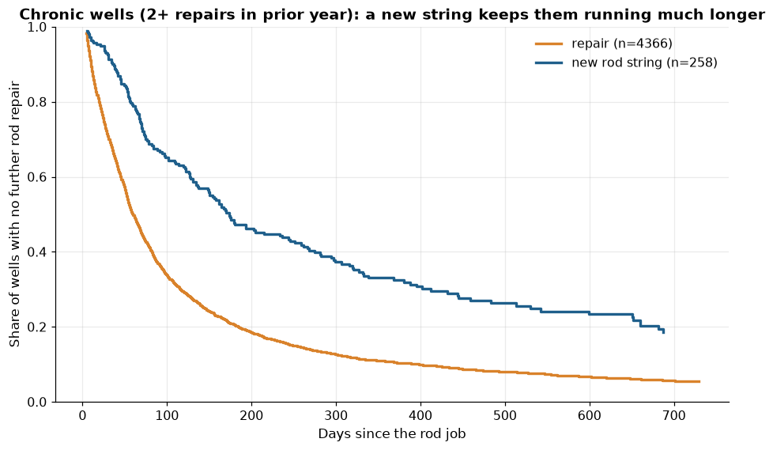
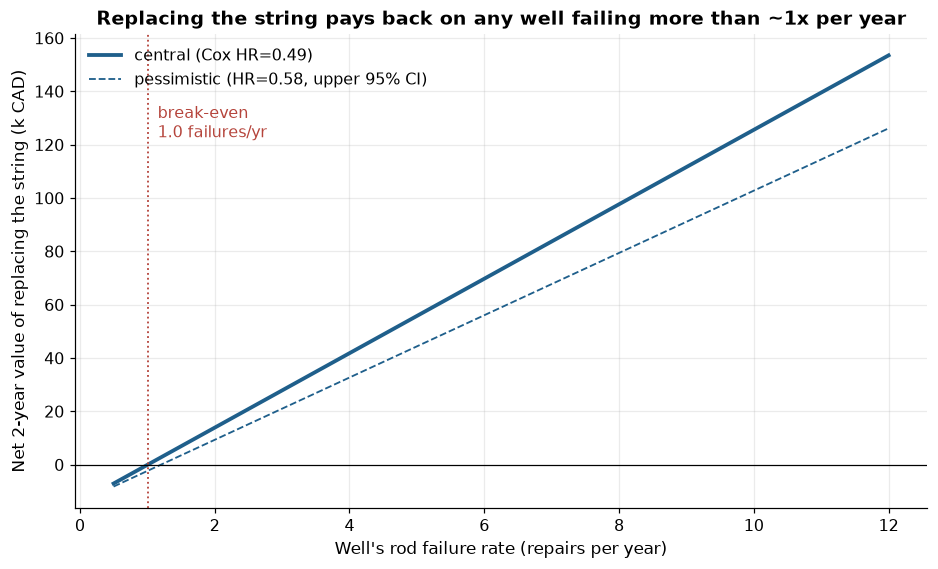

# Idea 1 - Stop patching, start replacing: a rod-string replacement program for chronic-failure wells

Scripts: `python data/ideas/1/rod_replace_analysis.py` (about 25 s).
Numbers: `data/ideas/1/out/results.txt`.
Ranked well list: `data/ideas/1/out/chronic_wells.csv`.
Price assumptions: `data/ideas/common.py`.

## a. Problem

- Downhole rod, pump and tubing failures are the largest recoverable production loss in the dataset.
  They account for 37,525 m3/yr of lost oil, or $16.5M/yr at a $438/m3 field-gate price (idea 3 script).
  On top of that come the repair jobs themselves.
- The bill is concentrated.
  Over 2021-2026 the all-in downhole failure cost (failure-type repair jobs plus lost oil) is $250.1M across 1,208 wells.
  The top 10% of wells (120) carry 30.2% of it, and the top 20% carry 48.3%.
- Chronic wells are typically patched, not fixed.
  The data has 7,972 deduplicated rod jobs: 7,617 repairs (re-pin, replace a broken section) and only 355 full rod-string replacements.
- Right now 145 wells have had 3 or more rod repairs in the last 365 days and no new string.
  Together they logged 678 rod repairs in a year, at an all-in cost of $8.97M (repair jobs + lost oil).
  The worst well (109101004225W300, Winter) had 17 rod repairs in 12 months.

## b. Research question

For PCP wells with repeated rod failures, does replacing the whole rod string instead of repairing it lower the rate of the next rod failure?
At what failure frequency does replacement pay for itself?

- **Target metric 1:** the adjusted hazard ratio (HR) of the next rod repair after a replacement vs after a repair, controlling for failure history, liquid rate, RPM, area and year.
  A useful effect is HR <= 0.7.
- **Target metric 2:** the break-even failure rate (failures/yr) above which replacement has a positive 2-year net value.
- **Target metric 3:** the CAD net value of a replacement program on the current chronic-well list.

## c. Evidence

**Cost is concentrated in a minority of wells.**

**At every level of failure history, wells that got a new string fail less in the next year.**
This holds for rod repairs per producing year in the 365 days after the job, on events from 2022 onward with a full year of follow-up:

| Repairs in prior 365 d | After repair | After new string | n (repair / replace) |
|---|---|---|---|
| 0 | 1.95 | 1.07 | 931 / 35 |
| 1 | 2.58 | 0.91 | 881 / 27 |
| 2 | 2.89 | 2.25 | 810 / 34 |
| 3-4 | 3.43 | 1.91 | 1,170 / 63 |
| 5+ | 4.76 | 2.74 | 1,420 / 71 |

**A Cox proportional-hazards model gives the same answer after adjustment.**
The model is stratified by area x year, uses events from 2022 onward, has 6,909 events of which 5,735 were followed by another repair, and caps follow-up at 730 days.

| Covariate | HR | 95% CI |
|---|---|---|
| New rod string (vs repair) | **0.485** | 0.422-0.559 |
| log(1 + prior-365 d repairs) | 1.411 | 1.354-1.469 |
| RPM / 100 (30-d mean before job) | 0.968 | 0.936-1.002 |
| log(1 + liquid rate) | 1.107 | 1.074-1.140 |

- On chronic wells only (2+ prior repairs; n = 4,608, 257 replacements) the HR is **0.495** (95% CI 0.424-0.577).
- RPM has almost no adjusted effect.
  This matches the screening result: the raw link between RPM and failure is mostly a between-well effect (see README, killed ideas).

**Economics.**
Replacing pays back on any well failing more than about once a year.

**Who is on the list.**
The 145 program wells are spread over Winter (55), Cactus Lake (37), Court (16), Cosine (13), Druid Main (12), Bodo East (8), Bellis (3) and Druid North East (1).
By dominant failure-log cause, 69 are mostly Fatigue, 52 Corrosion and 17 Load / Excess Stress.

## d. Domain research

- **How a PCP rod string is loaded.**
  The surface drive turns the rotor through the rod string, so the string carries axial load (mostly the weight of the fluid column) and torque together.
  Designers combine the two into an effective von Mises stress.
  Fatigue also has to be checked in some applications, for example deviated wells where the rotating string sees cyclic bending.
  Source: [PetroWiki, Rod and tubing design for PCP systems](https://petrowiki.spe.org/Rod_and_tubing_design_for_PCP_systems).
- **Rotating-bending fatigue in deviated wells.**
  C-FER's drive-string fatigue work notes that lab fatigue tests may not reflect field behaviour once constant torsional and axial stresses are added to cyclic bending.
  Source: [C-FER Technologies](https://www.cfertech.com/?p=6841), read via search summary.
- **Corrosion fatigue.**
  Many "fatigue" breaks start at corrosion pits.
  Weatherford reports an Alberta slant heavy-oil well whose continuous-rod (COROD) run life went from 3 months to more than 7 years after a change to D-grade steel plus an effective inhibition program.
  This is a vendor-reported case.
  Source: [Weatherford case study](https://www.weatherford.com/documents/real-result/production/artificial-lift-systems/effective-inhibition-program-provides-significant-increase-in-corod-continuous-rod-run-life-in-high).
  The claim that corrosion contributes in over half of failures classified as fatigue came from a search summary of [World Oil, June 2024 artificial lift article](https://read.nxtbook.com/gulf_energy_information/world_oil/june_2024/sf_artificial_lift_dun_liftin.html) [unverified, not read in full].
- **Why history predicts failure.**
  Rod strings accumulate damage (pitting, wear at tubing contact, connection fatigue).
  A repair replaces only the broken section, and the rest of the string keeps its accumulated damage.
  That is the engineering reason a replacement should reset the hazard and a repair should not.
  The Cox result (HR 0.49, and prior repairs HR 1.41 per log unit) is consistent with this.
- **Industry practice of root-cause failure analysis.**
  An SPE/JPT case reports that a root-cause failure analysis (RCFA) program cut PCP failure frequency from 0.47 to 0.21 failures per well-year in Chad.
  Source: [JPT, Applying root cause failure analysis enhances artificial lift performance](https://jpt.spe.org/applying-root-cause-failure-analysis-enhances-artificial-lift-performance), read via search summary.
- **Benchmarks.**
  A Permian Basin sucker-rod study gives about 0.22 rod failures per well-year.
  Source: [Texas Tech thesis](https://ttu-ir.tdl.org/handle/2346/16616?show=full), read via search summary.
  The 145 program wells here average 678 / 145 = 4.7 rod repairs per year, more than 20x that benchmark.
  The lift type and wells differ, so this is context only.

## e. Proposed solution

**Form:** implementation plan backed by a decision-support tool (ranked well list + per-well economics).

**Architecture.**
1. A nightly job reads `well_jobs` and the daily file.
2. It rebuilds the rod-event table, with deduplication and repair/replace classes.
3. It computes rolling 365-day rod repairs per well, plus the all-in cost (job `field_est_total` plus lost oil x price).
4. It applies the break-even rule from the Cox HR and current price.
   The output is `chronic_wells.csv`: well, area, repairs in last 365 d, all-in cost, dominant cause, corrosion share, and 2-year net value of replacement.

**What the operator sees and does.**
- The production engineer opens the list at the weekly rod-truck planning meeting.
- For each well at or above the threshold, the **next** rod failure triggers a full new string instead of a repair.
  A replacement costs $22,683 on average vs $8,672 for a repair, so the incremental $14,010 is charged only when the well is already being serviced.
- The dominant cause selects the specification:
  - Corrosion-dominant wells: replacement plus a batch inhibitor program (and a higher rod grade or coating).
  - Fatigue-dominant wells: check the rod size, rod guides and centralisers, and drive torque settings.
  - Load / Excess Stress wells: check the pump sizing and whether the well is pumped off.
- Every 90 days, a run-life chart per well shows whether the replacement reset the hazard.

## f. Validation plan

- **Time-based backtest.**
  Fit the Cox HR on events from 2022-01-01 to 2024-06-30.
  Predict the next-12-month repair counts for events from 2024-07-01 to 2025-10-27, with outcomes observed up to 2026-10-27.
  Compare predicted vs observed rates per action.
  No random split, because events on the same well are correlated over time.
- **Baseline to beat.**
  The status quo is "repair every time".
  Its next-year rate for chronic events (3+ prior repairs) is 4.16 repairs per producing year, against 2.35 after a replacement (raw 43.5% reduction).
  The adjusted HR has to stay clearly below 1 in the backtest window.
- **Metrics.**
  - HR and its 95% CI.
  - Observed vs predicted repairs per producing year.
  - Net CAD per replacement.
- **Leakage and bias checks.**
  - History features use only events strictly before the job date.
  - Repairs within 3 days of a job are merged into the same event, so one rig visit is not counted as "a failure right after".
  - Follow-up is censored at the well's last Producing day, so suspended wells do not count as "no failure".
  - Events in 2021 are excluded because their prior history is left-censored (the data starts 2021-01-01).
- **Confounders, and how we address them.**
  - *Selection:* engineers may replace strings on wells they already expect to improve (e.g. after an RCFA). We adjust for prior repairs, liquid rate and RPM, and stratify by area x year.
  - *Co-interventions:* a new string often comes with a pump change, an inhibitor or an RPM change. We cannot separate these, so the HR is the effect of "the replacement job as practised".
  - *Regression to the mean:* replacements follow failure clusters. The prior-count stratification in chart 1b compares like with like.
  - The strongest fix is a pilot: randomize the first 70 of the 145 program wells to replace-at-next-failure and keep the rest on repair for 6 months.

## g. Business impact (CAD)

**Price.**
- WTI $83.45 USD/bbl on 2026-11-19 ([OilPriceAPI table](https://www.oilpriceapi.com/live/wcs-crude-oil-price), indicative).
- WCS Hardisty December differential -$26.20 USD/bbl, settled 2026-11-13 (CalRock via Reuters, [BOE Report](https://boereport.com/2026/11/13/discount-on-western-canada-select-narrows-55/)).
- That gives WCS = 83.45 - 26.20 = $57.25 USD/bbl.
- USD/CAD 1.4325 on 2026-11-20 ([Bank of Canada](https://www.bankofcanada.ca/rates/exchange/daily-exchange-rates/)).
- 57.25 x 1.4325 = $82.01 CAD/bbl, and x 6.2898 bbl/m3 = $515.8 CAD/m3.
- Field-gate haircut of 15% for transport, blending and quality [assumption, unverified]: 515.8 x 0.85 = **$438.5 CAD/m3**.
- We value lost oil at revenue, not margin. Royalties and opex would lower it.

**Unit costs (script output).**
- Mean rod repair job cost (cost > 0, 2023+) = $8,672.
- Mean lost oil per rod repair event = 11.72 m3 (downhole-coded lost oil from 7 days before the job to 1 day after it).
  At $438.46/m3 that is $5,140.
- All-in cost per rod failure = 8,672 + 5,140 = **$13,812**.
- Incremental cost of replacing instead of repairing = 22,683 - 8,672 = **$14,010**.

**Per-well rule.**
- Avoided failures per year = lambda x (1 - HR) = lambda x (1 - 0.495) = 0.505 lambda.
- Net value over a 2-year horizon [assumption: 2 years of benefit counted] = 0.505 lambda x 2 x 13,812 - 14,010.
- Break-even lambda = 14,010 / (0.505 x 2 x 13,812) = **1.0 failure/yr**.

**Program on the current list (145 wells, 678 repairs in the last 365 d).**
- Avoided failures over 2 years = 678 x 0.505 x 2 = 685.
- Gross value = 685 x 13,812 = $9.46M.
- Incremental cost = 145 x 14,010 = $2.03M.
- Net = **$7.43M over 2 years (about $3.7M/yr)**.
- Pessimistic case (upper 95% CI, HR 0.577): **$5.89M** over 2 years.
- With the raw (unadjusted) rate reduction of 43.5%: $6.12M.

**Sensitivity (script output, 145 program wells).**

| Scenario | Break-even (failures/yr) | Program net (CAD) | Wells with positive value |
|---|---|---|---|
| Central | 1.00 | $7.43M | 145 |
| HR at upper 95% CI (0.577) | 1.20 | $5.89M | 145 |
| Lost oil = median per event (7.33 m3) | 1.17 | $6.11M | 145 |
| Lost oil ignored (job cost only) | 1.60 | $3.91M | 145 |
| Oil price -30% | 1.13 | $6.38M | 145 |
| Incremental replace cost x2 | 2.01 | $5.40M | 145 |
| 1-year horizon | 2.01 | $2.70M | 145 |
| All pessimistic at once (upper CI HR, job cost only, cost x2, 1 yr) | 7.64 | **-$1.58M** | 14 |

The program stays positive under each single stress.
Only when every pessimistic assumption is stacked together does it turn negative.
Even then, the 14 wells failing 8 or more times a year still pay back, so the rule degrades to "replace on the worst 14 wells" rather than failing.

**Not counted.**
- Crew and rig capacity freed (about 340 fewer rod-truck calls per year).
- Safety exposure from fewer well interventions.

## h. Limitations and risks

- **Replacement cost may be understated.**
  If rod material for a new string is booked outside `field_est_total`, the incremental cost rises and the break-even moves up.
  Strathcona should confirm. If the incremental cost doubled to $28,020, the same formula puts break-even at 2.0 failures/yr, and every program well has 3 or more.
- **Small replacement sample.**
  There are 355 replacements in total and 257 on chronic wells. The CI is reported for this reason.
- **Unmeasured co-interventions and selection** (see f).
  This is the main threat to the causal claim. The pilot design addresses it.
- **Lost-oil window.**
  The -7..+1 day window can overlap the previous event on very frequent failers, which would slightly overstate lost oil per event.
- **Repair cost data** is missing for 2021-2022 (see data quality doc), so costs use 2023+ jobs only.
- **2-year horizon is an assumption.**
  Strings that last longer give more value, and the KM curve in chart 1c still shows about 20% of replaced chronic wells with no repair after 700 days.

## i. Canary fit

Moderate fit.
- Rod-repair counts and cost are event data, not sensor streams, but Canary can hold them as tags:
  - a calculated tag per well, `rod_repairs_365d`, from a job-event tag
  - an Event in Calcs & Events that fires when it reaches 3 or more
  - an Axiom table of chronic wells next to each well's oil-rate trend.
- Canary documents condition-based events with a minimum duration and an Events Table control in Axiom ([Canary Calcs & Events 301](https://helpcenter.canarylabs.com/t/p8h5hl9/calcs-events-301), [Canary Event Monitoring](https://canarylabs.com/product/events)).
- This is credible but not the core of the idea. Idea 2 or 3 uses Canary more naturally.

## j. Build plan (to Sunday 12:00)

- **Already done:** the analysis script, 4 charts, the ranked list and the economics.
- **Saturday evening:**
  1. A time-split backtest script (fit to 2024-06, test after).
  2. A sensitivity table for price, haircut, replacement cost and horizon.
  3. A one-page "replace-at-next-failure" decision card per area.
- **Sunday morning:** slides (problem -> chart 1b -> Cox table -> break-even -> list -> pilot design) and the 5-minute video.
- **Cut-down version:** skip the backtest and present charts 1b and 1c, the Cox table and break-even arithmetic, with the pilot as the validation plan.

## k. Rubric self-score

| Criterion (weight) | Score | Why |
|---|---|---|
| Research depth and domain (25%) | 4 | Rod-string mechanics, corrosion fatigue and RCFA tie directly to the result. Repair vs replace is a real operator decision. |
| Technical implementation (25%) | 4 | Survival analysis with censoring, adjustment and deduplication. Reproducible. Backtest still to run. |
| Insight and business impact (20%) | 5 | Concrete action, ranked list, about $7.4M over 2 years with stated assumptions and a pessimistic case. |
| Presentation (15%) | 4 | One chart (1b) carries the story, and the break-even rule fits in one line. |
| Creativity (15%) | 3 | Survival analysis is standard. The framing (decision rule plus randomized pilot) is the differentiator. |
| **Weighted** | **4.05** | 0.25x4 + 0.25x4 + 0.20x5 + 0.15x4 + 0.15x3 |
