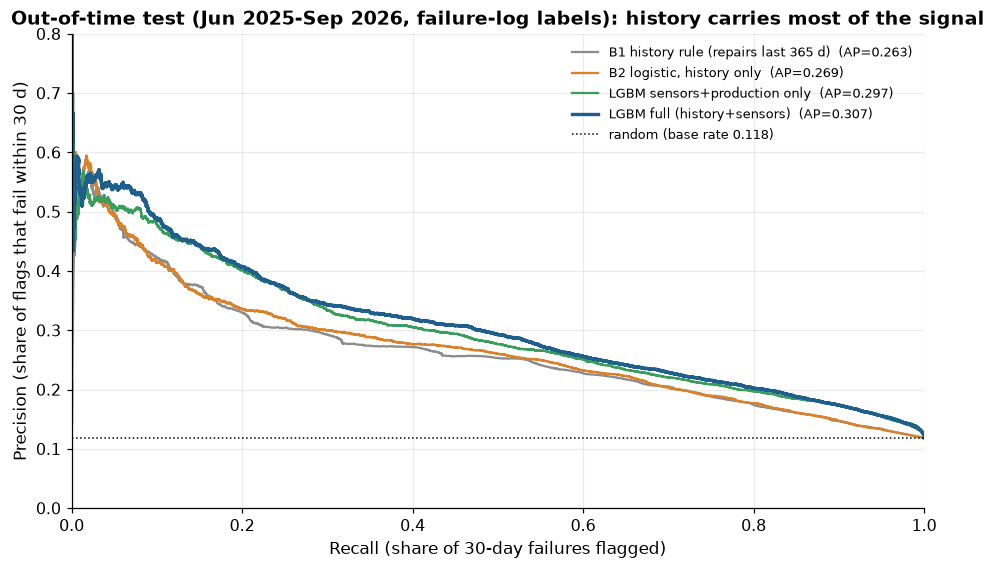
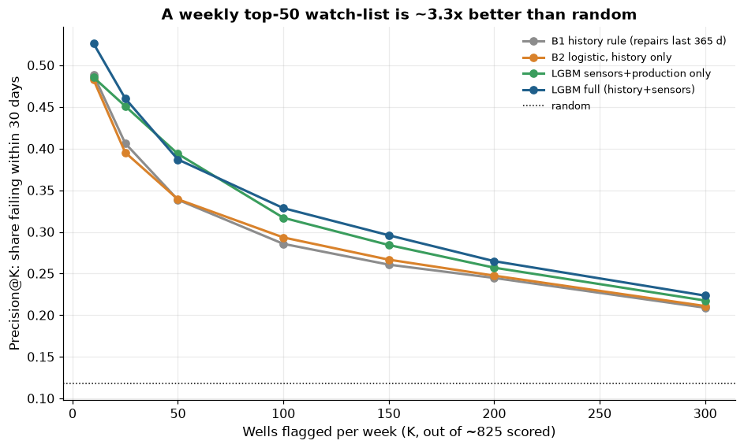
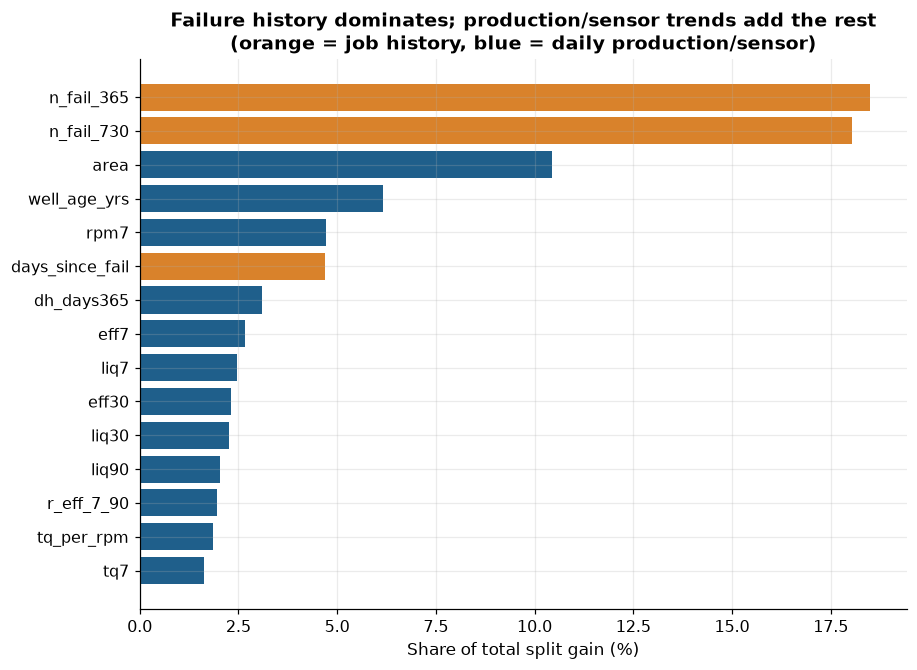
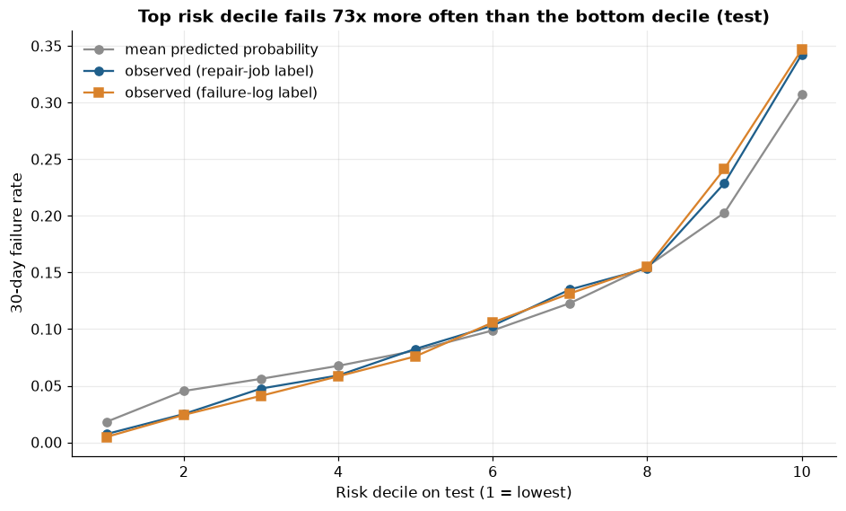

# Idea 2 - Weekly downhole-failure watch-list: a leakage-safe 30-day risk model

Scripts:
- `python data/ideas/2/build_features.py` (about 20 s, builds weekly snapshots)
- `python data/ideas/2/train_eval.py` (about 50 s)

Numbers are in `data/ideas/2/out/results.txt`.

## a. Problem

- Rod, pump and tubing failures cause 37,525 m3/yr of recoverable lost oil ($16.5M/yr at $438/m3; idea 3 script).
- Repair jobs linked to failures from Jun 2025 to Oct 2026 cost $29.54M for rods (2,158 failures), $14.53M for pumps (358) and $10.99M for tubing (240).
  These come from screening section S9 (`data/ideas/00_screening/screen.py`), which links a job to a failure when it starts between 3 days before and 14 days after the failure date.
  A job shared by two close failures is counted twice, so treat these totals as an upper bound.
- Roughly 170 downhole failures are logged per month (Jun 2025 to Oct 2026, profile script).
- Every one is unplanned: the well goes down and then a rod truck or rig is called.
- The data shows wells ramp down for days before the logged failure date.
  Mean hours down goes from 2.9 h at day -14 to 18.1 h at day -1, so production is already being lost before anyone books the failure.

## b. Research question

Using only data available up to a given Monday, can we rank currently-running producing wells by their probability of a downhole (rod/pump/tubing) failure in the next 30 days?
Can that ranking beat the rule an experienced engineer would use ("watch the wells that failed most last year")?

- **Target metric:** precision@50 per weekly list (share of the top-50 flagged wells that fail within 30 days) on an out-of-time test (Jun 2025 to Sep 2026), against the failure log.
- **Success threshold:** beat the history rule by at least 10% relative, with PR-AUC above the history rule.

## c. Evidence

**Setup.**
- 229,262 weekly snapshots (Monday t, well Producing and fully up on t-2..t).
- 41 features using rows dated on or before t:
  - job history: repairs in last 90/365/730 d, days since last repair, days since last string replacement
  - production: 7/30/90-day oil and liquid, water cut, ratios and slope
  - pump: efficiency, RPM, torque, current, tubing and casing pressure, torque per RPM, volumetric efficiency, past down-days, past downhole-coded days, "Well Torqued" days
  - area and pump make.
- **Label:** a failure-type repair job starts in (t, t+30].
  On test it is also checked against the failure log.

| Split | Weeks | Rows | Wells | 30-d failure base rate |
|---|---|---|---|---|
| Train | 2022-01-03 to 2023-11-30 | 79,432 | 1,066 | 0.118 (jobs) |
| Valid (early stopping) | 2024-01-01 to 2024-11-30 | 40,239 | 1,058 | 0.119 (jobs) |
| Test (failure-log era) | 2025-06-01 to 2026-09-27 | 54,532 | 1,083 | 0.118 (jobs) / 0.119 (failure log) |

**Out-of-time test results (failure-log label).**

| Model | ROC-AUC | PR-AUC | Precision@50/week | Recall@50 | Precision@100 |
|---|---|---|---|---|---|
| B1 history rule (repairs last 365 d) | 0.716 | 0.263 | 0.339 | 0.181 | 0.286 |
| B2 logistic, history only | 0.720 | 0.269 | 0.339 | 0.181 | 0.293 |
| LightGBM, sensors + production only | 0.757 | 0.297 | 0.394 | 0.210 | 0.317 |
| **LightGBM full** | **0.764** | **0.307** | 0.387 | 0.207 | **0.329** |

- The full model lifts precision@50 from 0.339 to 0.387 (+14% relative) and precision@100 from 0.286 to 0.329 (+15%).
- A random pick would hit 0.119.
- Job labels and failure-log labels give nearly identical numbers, so the jobs proxy used in training is sound.

**What drives it.**
- Failure history (n_fail_365 18.5% of gain, n_fail_730 18.1%), then area (10.4%), well age (6.2%), RPM (4.7%) and days since last failure (4.7%).
- Short-term "trend" features (7-vs-90-day torque, current and efficiency ratios) each carry about 2% or less.
- This matches the profiling finding that torque, current and RPM change only every 19-35 days in this dataset.

**Calibration.**
The top risk decile fails at 34.7% within 30 days against 0.5% in the bottom decile (failure-log label).
Predicted and observed rates track closely across deciles.

**Lead time and coverage.**
- On test, the weekly top-50 list flagged 581 of 2,218 distinct failure events (26.2%) at least once before they happened.
- The median first flag came 21 days before the failure job.
- That is 439 flagged failures per year across 169 wells.

## d. Domain research

- **How PCP failures develop.**
  Many rod failures are fatigue or corrosion-fatigue, which is progressive damage that history captures.
  Others are sudden (a parted rod, a split joint), and trend-based models cannot predict those well.
  A multi-field rod-pump study (Zheng et al., SPE 165374) reported precision and recall around 65% with a global model.
  It attributed its weakest field to more sudden failures.
  Source: [JPT and patent summaries of SPE 165374](https://image-ppubs.uspto.gov/dirsearch-public/print/downloadPdf/9292799), read via search summary.
  That study used high-frequency dynamometer data, which this daily dataset does not have.
- **Card-based deep learning on beam pumps** reached F1 0.857 with a mean lead time of about 14 days (SPE 233386, [JPT](https://jpt.spe.org/prediction-of-sucker-rod-pump-failures-using-scaled-load-ratios-and-machine-learning)), read via search summary.
  The comparison is not like-for-like (beam pump vs PCP, high-frequency vs daily), but it shows what richer historian data could add.
- **PCP surveillance signals.**
  Rising drive torque at constant RPM points to higher friction (sand, a swelling elastomer, rod-tubing contact).
  Falling volumetric efficiency at constant RPM points to stator wear or slippage.
  Source: [PetroWiki, PCP systems](https://petrowiki.spe.org/Progressing_cavity_pump_(PCP)_systems), [PetroWiki, PCP systems for hostile fluid conditions](https://petrowiki.spe.org/PCP_systems_for_hostile_fluid_conditions).
  We built these features (torque per RPM, volumetric efficiency). They rank low here because the daily tags are rarely updated.
- **Leakage and timing.**
  The profile showed downtime starting before the logged failure date.
  A model scored on wells already down would look excellent and be useless.
  So we only score wells that were fully up on the last 3 days.

## e. Proposed solution

**Form:** AI/ML prototype (a weekly risk service plus an operator watch-list).

**Architecture.**
1. Historian tags and job records are aggregated into well-day features.
2. Every Monday the LightGBM model scores every running producer.
3. Scores are written back as a `failure_risk_30d` tag per well.
4. A watch-list of the top 50 wells (out of about 825) goes to the area production engineers.

**What the operator sees and does.**
- For each flagged well: its risk, its top 3 drivers (SHAP), recent oil/efficiency/torque trends and the last job.
- The response ladder, cheapest first:
  1. Check RPM and torque on the next lease round.
  2. Batch inhibitor or hot-oil if corrosion or wax is suspected.
  3. Slow the drive if torque is high.
  4. Pre-stage the rod truck and rods so the repair starts the same day the well goes down.
  5. For chronic wells, hand off to the idea 1 rule (replace the string at the next pull).

## f. Validation plan

- **Already done:**
  - Strict time split (train 2022-2023, valid 2024, test Jun 2025 to Sep 2026).
  - A 5-month gap between valid and test.
  - Final model refit on train+valid with early-stopped trees and scored once on test.
- **Baselines:** history rule B1 and logistic B2.
- **Metrics:** PR-AUC, ROC-AUC, precision and recall at K = 50/100 per week, event-level recall, lead time and decile calibration.
- **Leakage controls:**
  - The well must be up (hours down = 0, oil > 0) on t-2..t.
  - Features use only rows on or before t.
  - Downtime codes are used only as counts of past days, never the current event.
  - Labels come from a different source (jobs) than the test check (failure log), and the results agree.
  - 2021 is excluded from training because history features are left-censored.
- **Still to do:**
  - Rolling-origin backtest (retrain monthly).
  - Per-area performance, especially Winter vs Cactus Lake.
  - Exclude areas with no failure logging (Fenn Big Valley, CHO-Non-Op), which are currently left in the denominator.
  - Check stability of precision@50 week by week.

## g. Business impact (CAD)

The price derivation is the same as idea 1: WCS $57.25 USD/bbl x 1.4325 x 6.2898 = $515.8/m3, less 15% field-gate haircut [assumption] = $438.5/m3.

**Assumptions** (all marked [unverified]; to be set with Strathcona operations):
- A1: proactive action prevents 20% of flagged failures.
- A2: for flagged failures that still happen, pre-staging cuts lost oil by 30%.
- A3: each flag costs $200 in extra operator and engineering time.

**Inputs from the scripts.**
- 439 flagged failures per year.
- All-in cost per rod failure $13,812 (idea 1).
- Mean lost oil 11.72 m3 per failure.

**Arithmetic.**
- Avoided failures: 439 x 0.20 = 88/yr. 88 x $13,812 = **$1.21M/yr**.
- Faster repair on the remaining 351: 351 x (11.72 x 0.30) m3 x $438.5 = 351 x $1,542 = **$0.54M/yr**.
- Flag cost: 50 x 52.18 weeks x $200 = **-$0.52M/yr**.
- Net about **$1.23M/yr**.

**Honest framing.**
- The history rule alone captures most of this. The model's extra value is about 15% more correct flags at the same list size.
- Pump and tubing failures cost $34,076 and $39,851 median per failure (screening S9), not $13.8k, so mixing them in would raise the value.
  We kept the rod figure to stay conservative.

## h. Limitations and risks

- **Modest uplift over common sense.** A judge from operations can fairly say "we already watch our repeat failers".
- **Daily data limits physics signals.** Torque, current and RPM in this extract change every 19-35 days on average. The real historian likely has far richer data, so this is both a limitation and an upside.
- **Label noise.** Jobs include some non-failure work. In screening S9, 88.9% of Corod and 96.7% of Stick rod repairs match a failure record, against 72.0% of Pump Repair/Replacement and 78.7% of Tubing Repair jobs. PCP Upgrades (51.6%) are not in the label set.
- **Interventions change the outcome.** Once the list is used, prevented failures look like false positives. Evaluation must log the actions taken.
- **Area confounding.** Area is 10% of gain. The model partly learns where failures are logged.
- **Assumptions A1-A3** drive the CAD number and are unverified.

## i. Canary fit

**Strong fit.** This is how Canary is used in industry: historian -> calculations -> events -> operator view.

1. **Historian:** load the daily well tags (oil, water, RPM, torque, current, efficiency, pressures) into Canary Historian as one tag per well per signal.
2. **Calcs:** build the derived features (7/30/90-day means, torque per RPM, volumetric efficiency) as Canary calculated tags with backfill ([Canary product overview](https://www.canarylabs.com/product)).
3. **Model output written back:** a Python service reads through Canary Views, scores weekly and writes `failure_risk_30d` back as a tag.
4. **Events:** Calcs & Events fires a "High failure risk" event when the risk tag stays above threshold for a set minimum duration.
5. **Axiom:** a watch-list board (Events Table control), per-well trend panels (risk, oil, torque, efficiency), and an area roll-up.

Sources for the events behaviour: [Canary Calcs & Events 301](https://helpcenter.canarylabs.com/t/p8h5hl9/calcs-events-301), [Canary Event Monitoring](https://canarylabs.com/product/events).

## j. Build plan (to Sunday 12:00)

- **Done:** feature pipeline, model, baselines, test metrics and 4 charts.
- **Saturday evening:**
  1. SHAP top-3 drivers per flagged well.
  2. Exclude non-logging areas and re-run.
  3. Export weekly scores to CSV.
  4. Load 20-30 demo wells' tags plus the risk tag into Canary.
  5. Configure one event and one Axiom board.
- **Sunday morning:** record a replay of 8 weeks of test data showing the watch-list updating.
- **Cut-down version:** no Canary. Show a static HTML/Matplotlib watch-list for one test week, plus the PR and precision@K charts.

## k. Rubric self-score

| Criterion (weight) | Score | Why |
|---|---|---|
| Research depth and domain (25%) | 3 | Leakage finding and PCP signal reasoning are good, but the model mostly relearns history. |
| Technical implementation (25%) | 4 | Clean time split, baselines, leakage controls and calibration. |
| Insight and business impact (20%) | 3 | About $1.2M/yr rests on unverified intervention assumptions, with a modest uplift over the history rule. |
| Presentation (15%) | 4 | The watch-list is easy to show live. |
| Creativity (15%) | 3 | Predictive maintenance is the expected entry. Many teams will try it. |
| **Weighted** | **3.40** | 0.25x3 + 0.25x4 + 0.20x3 + 0.15x4 + 0.15x3 |
