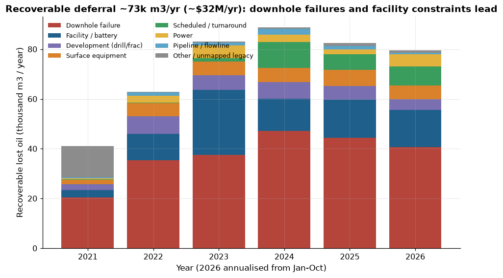
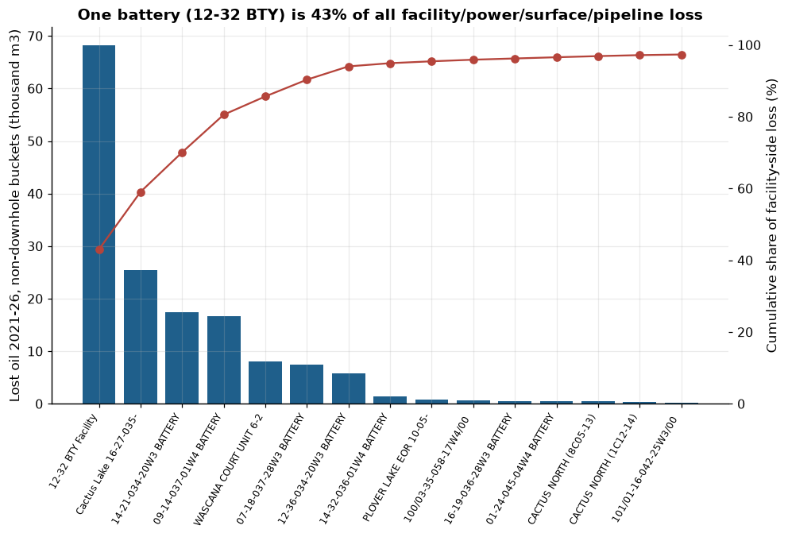
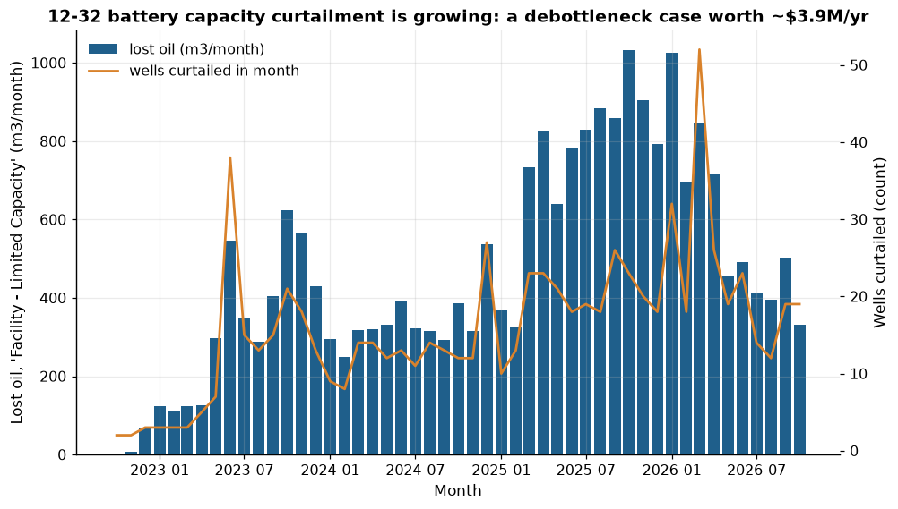
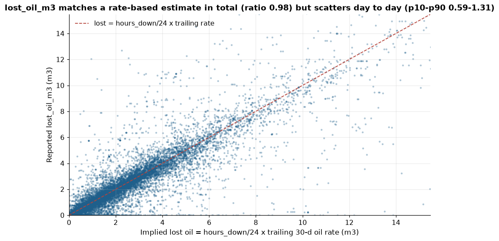

# Idea 3 - Deferred-production command center: one trusted loss number, by cause, facility and episode

Script: `python data/ideas/3/deferral_analysis.py` (about 10 s).
Numbers: `data/ideas/3/out/results.txt`.

## a. Problem

- Strathcona loses about **72,798 m3/yr of recoverable oil**, worth **$31.9M/yr** at $438.5/m3.
  These are Producing wells, excluding uneconomic shut-ins, over 2021-01-01 to 2026-10-27.
- That is 5.4% of the 1,343,170 m3/yr actually produced (screening S1).
- The loss is hard to manage from the raw data, for four reasons:
  1. Two downtime-code taxonomies are mixed (72 `downtime_code_2` values, long names next to legacy codes such as `RODSPART` or `UNPLNDW`).
  2. Uneconomic shut-ins are booked as "lost oil" on rows flagged Producing. They add 26,877 m3/yr of loss that is not recoverable.
  3. The loss is spread over 140 facilities and 9 cause families.
  4. Nobody can see at a glance which episodes are dragging on.

| Bucket | Lost oil m3/yr | CAD/yr |
|---|---|---|
| Downhole failure | 37,525 | $16.45M |
| Facility / battery | 13,775 | $6.04M |
| Development (drill/frac shut-ins) | 5,294 | $2.32M |
| Surface equipment | 5,080 | $2.23M |
| Scheduled / turnaround | 4,239 | $1.86M |
| Power | 2,956 | $1.30M |
| Other / unmapped legacy | 2,719 | $1.19M |
| Pipeline / flowline | 1,211 | $0.53M |
| *Uneconomic / LTSI (excluded)* | *26,877* | *not recoverable* |

## b. Research question

Which controllable causes, facilities and long-running episodes account for most recoverable deferred oil?
How much could a daily loss-accounting view with episode-age alarms recover?

- **Target metric:** recoverable deferred oil (m3/day, and CAD) per cause and facility, tracked weekly.
- **Goal:** a 10% reduction in non-downhole controllable loss, plus a 25% reduction in loss from downhole episodes longer than 7 days, within 12 months.

## c. Evidence

**Loss by cause and year.**
Downhole failures dominate every year.
Facility loss peaked in 2023 at 26,295 m3/yr.
2021 carries mostly legacy, unmapped codes (12,605 m3), which is itself a data-quality finding.

**Facility Pareto.**
For non-downhole controllable loss (facility, power, surface, pipeline, scheduled), 2 of 140 facilities carry 59% and 4 carry 81%.
12-32 BTY alone is 43.0% (68,283 m3 over 2021-2026).

**A growing capacity bottleneck at 12-32 BTY.**
"Facility - Limited Capacity" lost oil at this battery grew as follows:
- 2023: 3,985 m3
- 2024: 4,074 m3
- 2025: 8,977 m3
- 2026: 5,868 m3 (Jan-Oct)

Across 2025-2026 that is 14,845 m3, or 5.36% of the battery's 277,217 m3 of production.
Screening S11 checked whether operators curtail the wrong wells.
They do not: on constrained days, curtailed wells have a pooled oil cut of 0.63%, against 2.21% for wells left running.
So the lever is capacity (water handling), not which wells get shut in.

**Long episodes.**

| Bucket | Episodes | Median days | P90 days | Share of loss from episodes > 7 days |
|---|---|---|---|---|
| Downhole failure | 12,153 | 3 | 13 | **55%** |
| Facility / battery | 18,323 | 1 | 3 | 51% |
| Power | 18,649 | 1 | 1 | 1% |
| Surface equipment | 8,493 | 1 | 3 | 28% |
| Development | 962 | 5 | 25 | 81% |

Over half of downhole loss comes from the minority of episodes that drag past a week, for example waiting on a service rig.
This is what an episode-age alarm targets.

**Can `lost_oil_m3` be trusted?**
We compared it with an independent estimate: hours_down / 24 x the well's trailing (8-37 day) up-day oil rate.
- Over 161,482 down-days in recoverable codes, the totals agree (352,042 vs 359,301 m3, ratio 0.98).
- The correlation is 0.707.
- Day to day it scatters: the median ratio is 0.978, with a p10-p90 range of 0.59-1.31.

So the field estimate is unbiased in aggregate and fine for Pareto views, but noisy per well-day.
The dashboard shows both.

## d. Domain research

- **Production loss management.**
  Operators track losses against a predicted production capacity, split into planned, unplanned and external.
  "Unplanned production efficiency" is the metric they watch most closely, because it excludes planned and external downtime.
  Source: [SPE/JPT, Unplanned downtime in the Gulf of Mexico](https://jpt.spe.org/unplanned-downtime-gulf-mexico-significant-production-loss-management-opportunity-producers), read via search summary.
  Our buckets follow that split:
  - planned = Scheduled, Development
  - unplanned = Downhole, Facility, Surface, Pipeline
  - external = Power grid
  - excluded = Uneconomic.
- **Standards.**
  ISO/TR 20815-style production-efficiency reporting and the UK regulator's production-efficiency guidance both classify losses at facility level with consistent categories.
  Sources: [BSI listing](https://knowledge.bsigroup.com/products/petroleum-petrochemical-and-natural-gas-industries-calculation-and-reporting-production-efficiency-in-the-operating-phase-1), [NSTA PE guidance](https://www.nstauthority.co.uk/media/4265/oga_pe_guidance_presentation_v2.pdf), both read via search summary.
  The two-taxonomy problem here is exactly what those standards address.
- **Heavy-oil battery constraints.**
  Heavy-oil wells produce mostly water (on constrained facility-days, wells left running have a pooled trailing oil cut of only 2.21%, i.e. about 98% water, screening S11).
  Battery capacity is therefore usually limited by water handling and disposal, not oil treating.
  That is why debottlenecking 12-32 BTY means adding water capacity [domain reasoning; Strathcona to confirm the actual constraint].
- **PCP restarts after power loss.**
  Power outages here are short (median 1 day, 1% of loss in episodes over 7 days), which suggests restarts are handled well.
  Power is therefore a low-priority lever, and the data supports deprioritizing it.

## e. Proposed solution

**Form:** analytical dashboard.

**Architecture.**
1. Daily well rows feed a cleaning layer: the sentinel rules in `common.CLEAN`, and the code-to-bucket map (`BUCKET` in the script).
2. A daily loss table holds well x day x bucket x lost oil, with both the reported and the rate-based estimate.
3. An episode builder groups consecutive down-days in the same bucket.
4. Four views:
   - **Today:** wells down now, sorted by lost m3/day, with episode age. Episodes older than 7 days are highlighted.
   - **Pareto:** cause x facility x area for any period.
   - **Facility page:** the 12-32 BTY capacity trend, wells curtailed, and oil cut of curtailed vs running wells.
   - **Data-quality panel:** unmapped codes, Uneconomic-on-Producing rows, and reported vs implied loss divergence.

**What the operator does.**
- At the morning call, the foreman works the "Today" list top-down.
- Any downhole episode past 7 days escalates to the rig scheduler.
- The facility engineer uses the 12-32 page to justify a water-handling debottleneck AFE.

## f. Validation plan

- **Backtest the alarm, using a time split.**
  Use 2021-2024 to set alarm thresholds (episode age, loss rate). Measure on 2025-2026 how much loss came after the alarm would have fired.
  That gives the "addressable" share without any random split.
- **Baseline:** current practice, i.e. the reported loss with no episode-age escalation. Its addressable loss is the share from episodes over 7 days: 55% of downhole loss.
- **Metrics:**
  - recoverable m3/day by bucket, week over week
  - share of loss from episodes over 7 days
  - median episode length per bucket
  - reported vs implied loss ratio.
- **Leakage and bias:**
  - This is descriptive, so there is no target leakage.
  - The main risk is definitional: double counting between Uneconomic and Producing.
  - The rate-based check gives an independent cross-check on `lost_oil_m3`.
- **Causality:** claims of "recovered" oil after rollout must be compared with a pre-period and with facilities that were not yet onboarded, a difference-in-differences design. Oil price and development activity change the Uneconomic and Development buckets over time, so those buckets are reported separately.

## g. Business impact (CAD)

**Price:** WCS $57.25 USD/bbl x 1.4325 USD/CAD x 6.2898 bbl/m3 = $515.8/m3, less a 15% field-gate haircut [assumption] = $438.5/m3 (derivation and sources in idea 1, section g).

1. **Long downhole episodes.**
   - Loss from downhole episodes over 7 days = 55% x 37,525 = 20,639 m3/yr.
   - A 25% reduction through escalation [assumption, unverified] = 5,160 m3/yr x $438.5 = **$2.26M/yr**.
2. **Other controllable buckets.**
   - Facility + Surface + Pipeline + Scheduled = 13,775 + 5,080 + 1,211 + 4,239 = 24,305 m3/yr.
   - A 10% reduction [assumption, unverified] = 2,431 m3/yr x $438.5 = **$1.07M/yr**.
3. **12-32 BTY debottleneck (upside, gross).**
   - 2025 capacity loss 8,977 m3 x $438.5 = **$3.94M/yr** of revenue at stake.
   - Net value depends on capex and water-disposal opex, which are not in the data.
   - Presented as a business case to investigate, not a saving.

**Total from 1 and 2: about $3.3M/yr**, plus the 12-32 case.
**Cost:** dashboard build and maintenance are small next to these figures. The real cost is the foreman's time at the morning call, which is already spent.

## h. Limitations and risks

- **The bucket map is ours, not Strathcona's.** Legacy codes such as `CODE3`, `CODE13` and `TA` are unmapped (2,719 m3/yr in "Other").
- **Lost oil is valued at revenue, not margin.**
- **The reduction percentages are assumptions.** The dashboard is only worth it if behaviour changes, which is hard to prove in a datathon.
- **Low novelty.** Judges may have seen many loss dashboards, so it needs the episode-age and data-trust angles to stand out.
- **The 12-32 BTY constraint type** (water, oil or gas) is not in the data.

## i. Canary fit

**Strongest fit of the three.** This is exactly how historians are used for loss accounting.

- **Historian:** per-well tags for hours down, oil, water and lost oil, plus a numeric-coded downtime bucket tag.
- **Calcs:**
  - the implied-loss tag (hours down x trailing rate)
  - an episode-age counter per well
  - facility roll-ups (sum of lost oil by `facility_name` asset model in Views)
  - built as calculated tags with backfill ([Canary product](https://www.canarylabs.com/product)).
- **Events:** "Downhole episode > 7 days" and "Facility capacity curtailment" as condition-based events with a minimum duration ([Calcs & Events 301](https://helpcenter.canarylabs.com/t/p8h5hl9/calcs-events-301)).
- **Axiom:** a morning-call board (events table plus Pareto), a facility drill-down and a 12-32 trend.

The Canary rubric asks for real-time monitoring, alarm management and performance tracking, and this idea is all three.

## j. Build plan (to Sunday 12:00)

- **Done:** bucket map, loss totals, facility Pareto, episode table, lost-oil validation and 4 charts.
- **Saturday evening:**
  1. Backtest the 7-day episode alarm (2021-24 tune, 2025-26 test).
  2. Export daily tags for about 2 facilities into Canary.
  3. Configure 2 events and the morning-call Axiom board.
- **Sunday morning:** screen-record the board replaying October 2026.
- **Cut-down version:** a Streamlit or static HTML dashboard (Today list, Pareto, 12-32 page) with no Canary.

## k. Rubric self-score

| Criterion (weight) | Score | Why |
|---|---|---|
| Research depth and domain (25%) | 3 | Loss-management practice and heavy-oil water handling are relevant but not deep engineering. |
| Technical implementation (25%) | 3 | Solid SQL and validation, but mostly descriptive with no model. |
| Insight and business impact (20%) | 4 | $31.9M/yr problem sizing, a concrete 12-32 case, and a data-trust finding. |
| Presentation (15%) | 5 | The most demo-able. Operators understand it instantly. |
| Creativity (15%) | 2 | Loss dashboards are the most common datathon entry. |
| **Weighted** | **3.35** | 0.25x3 + 0.25x3 + 0.20x4 + 0.15x5 + 0.15x2 |
