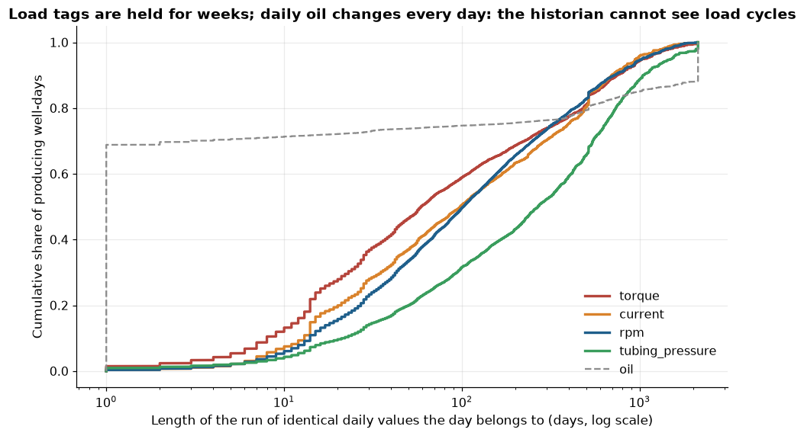
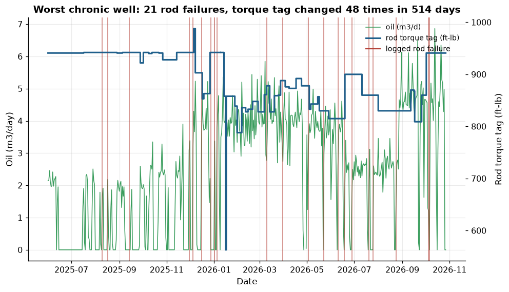
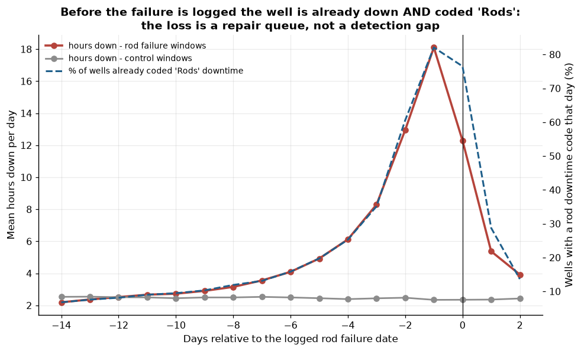
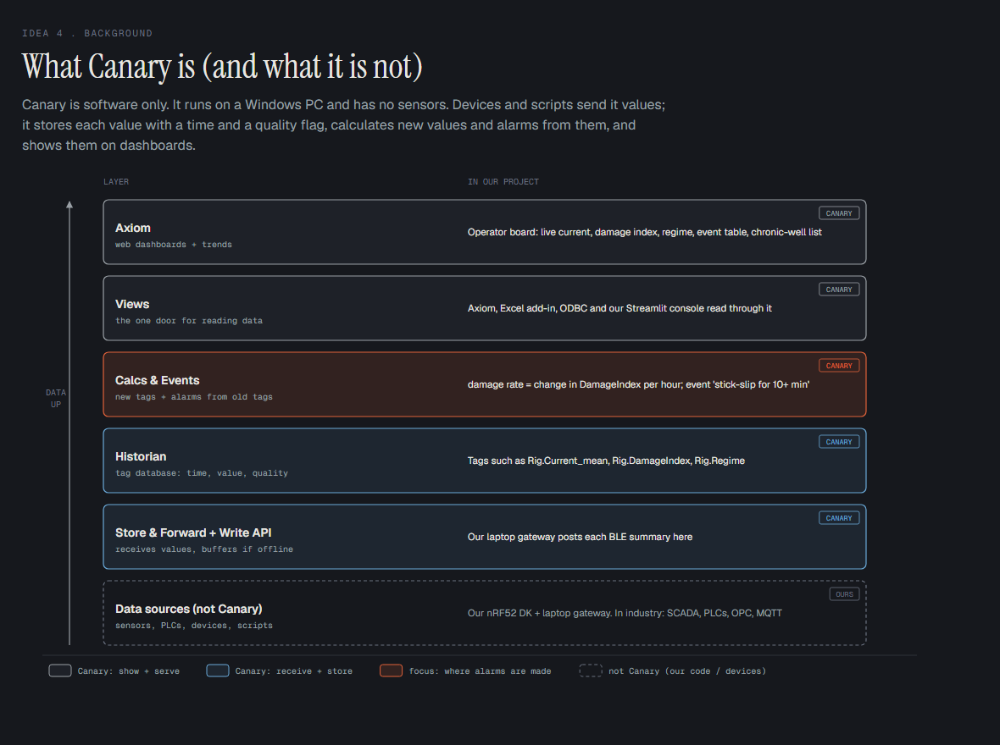
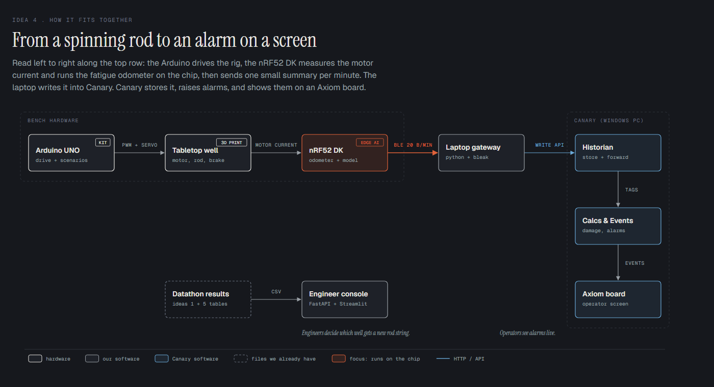
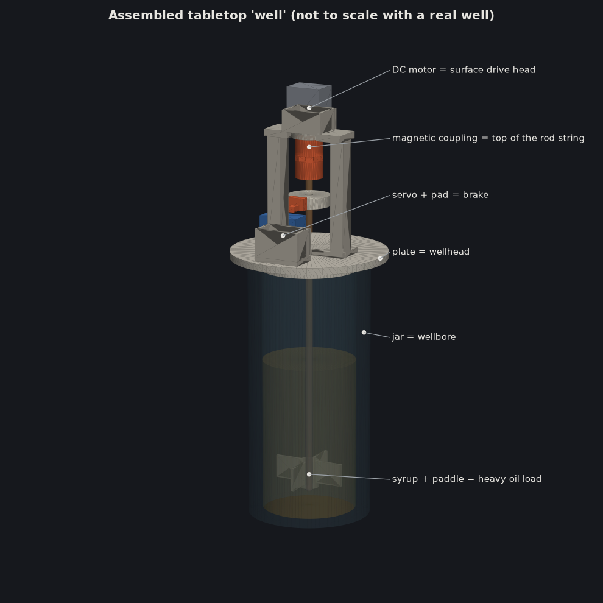
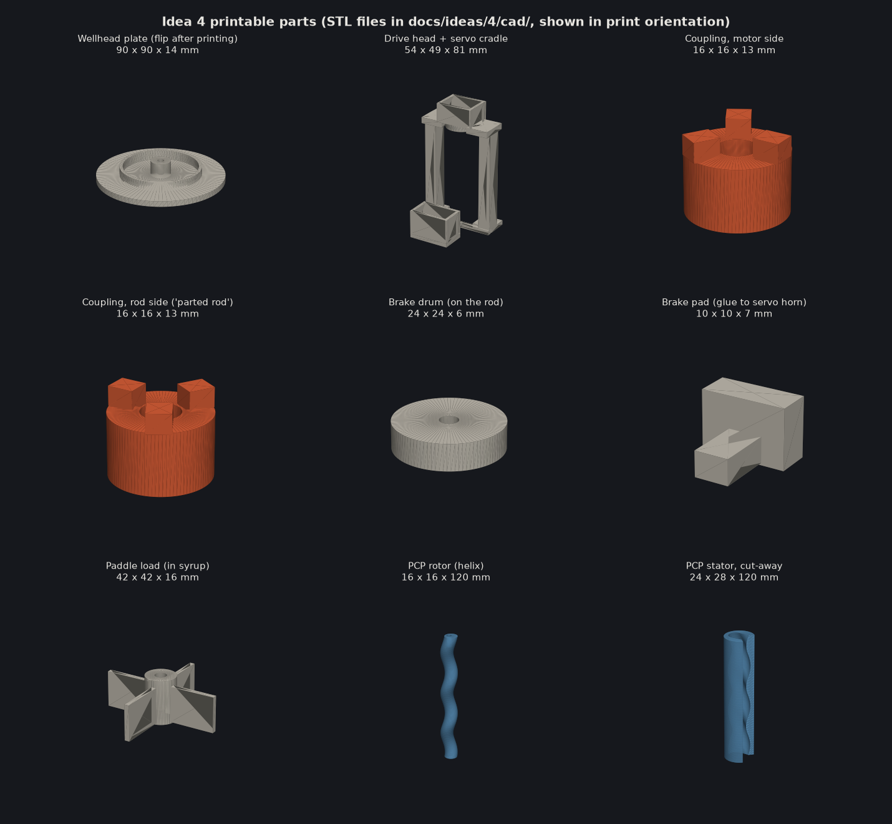
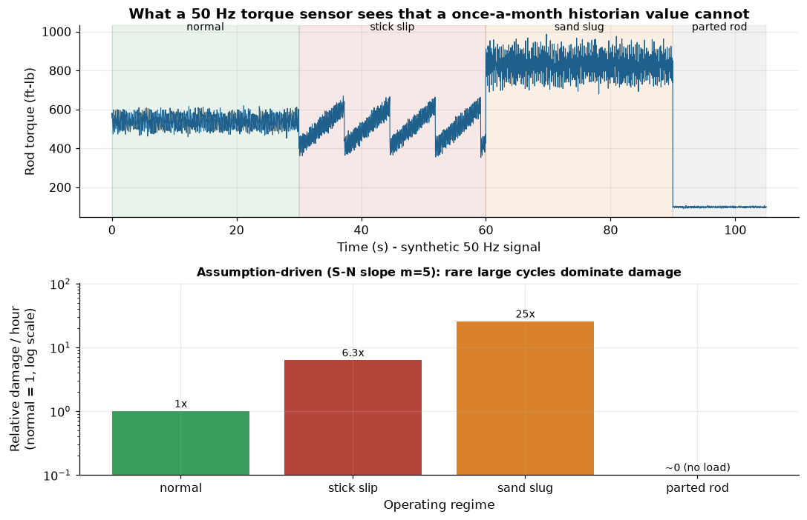
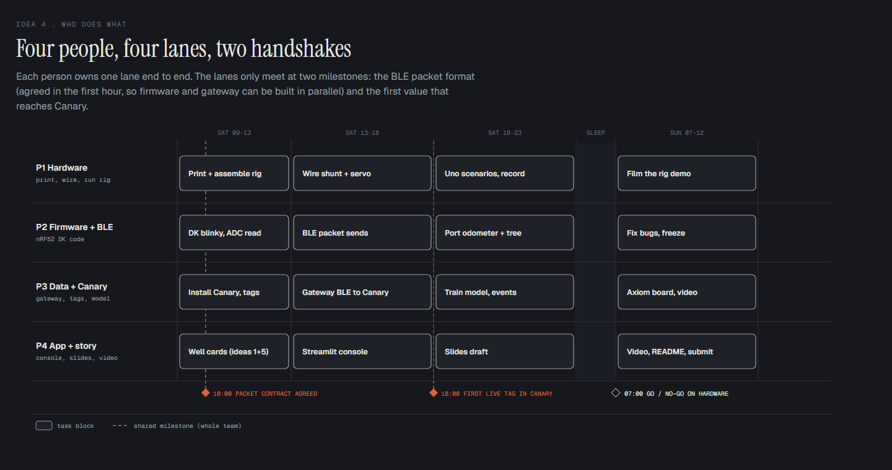

# Idea 4 build guide: the rod-string fatigue odometer

This guide is for a team that has never worked with oil-well data, embedded boards or Canary.
Read sections 1 to 4 together as a team (about 20 minutes).
After that, each person reads their own section in part 9.

The short technical version of this idea is in [idea.md](idea.md).
All numbers here come from the scripts in `data/ideas/4/` or from the cited sources.

## Contents

1. [The idea in one minute](#1-the-idea-in-one-minute)
2. [Words you need](#2-words-you-need)
3. [How a real heavy-oil well works](#3-how-a-real-heavy-oil-well-works)
4. [What the Strathcona data can and cannot see](#4-what-the-strathcona-data-can-and-cannot-see)
5. [What Canary is](#5-what-canary-is)
6. [How the whole system fits together](#6-how-the-whole-system-fits-together)
7. [The tabletop well: 3D-printed parts](#7-the-tabletop-well-3d-printed-parts)
8. [The software on the chip](#8-the-software-on-the-chip)
9. [Who does what: a plan for four people](#9-who-does-what-a-plan-for-four-people)
10. [The 60-second demo](#10-the-60-second-demo)
11. [Questions the judges will ask](#11-questions-the-judges-will-ask)
12. [What we have not checked yet](#12-what-we-have-not-checked-yet)

## 1. The idea in one minute

Strathcona's wells lift heavy oil with a pump at the bottom of the well.
A long steel rod connects that pump to a motor at the surface and turns it.
The rod breaks often.
The failure log has 2,186 rod failures, and most are coded Fatigue (1,074) or Corrosion (719).

Fatigue comes from load cycles: the rod twists more, then less, thousands of times.
The data we got has one torque value per day, and that value usually stays the same for weeks.
So the data cannot see the cycles that break the rod.

We build a small device that measures the load many times per second.
It counts the load cycles and adds up the damage they cause, like an odometer counts kilometres.
It sends one short summary per minute to Canary, the industrial database the sponsors use.
Canary raises an alarm when a rod has used up its life, so the crew can replace it during a planned visit and not after it breaks.

We prove it on a tabletop model of a well that we 3D-print.

## 2. Words you need

| Word | Meaning in this project |
|---|---|
| Heavy oil | Oil as thick as cold syrup. It does not flow up the well by itself, so every well needs a pump. |
| PCP (progressing cavity pump) | The pump at the bottom of the well. A metal corkscrew (the rotor) turns inside a rubber tube with a double corkscrew hole (the stator). Each turn pushes a pocket of fluid up. |
| Rod string | The long rod, hundreds of metres, that connects the surface motor to the pump. It is made of joined 7.6 m (25 ft) rods or one continuous rod (Corod). |
| Drive head | The motor and gearbox on top of the well that turns the rod string. |
| Torque | How hard the motor twists the rod. Unit in the data: ft-lb. On our rig we measure motor current, which rises and falls with torque. |
| Load cycle | One rise and fall of torque. |
| Fatigue | Metal cracking after many load cycles, even when each single load is safe. A paper clip bent back and forth breaks the same way. |
| Corrosion fatigue | Fatigue that starts at small corrosion pits. It breaks rods sooner than fatigue alone. |
| Stick-slip | The rod sticks, winds up like a spring, then slips and spins free. It makes large load cycles. |
| Rainflow counting | The standard method to count load cycles in a messy signal. |
| Miner's rule | Every cycle uses a small part of the rod's life. Add the parts. At 100% the rod is expected to break. |
| Damage index | Our running total from Miner's rule. 1.0 means "as much damage as one normal hour". |
| Edge AI | A small model that runs on the device itself, not in the cloud. |
| BLE | Bluetooth Low Energy, the radio on the nRF52 chip. |
| Historian | A database for sensor readings over time. |
| Tag | One named stream of readings in a historian, for example `Rig.Current_mean`. Each reading has a time, a value and a quality flag. |

## 3. How a real heavy-oil well works

The handbook describes the parts: the PCP at the bottom, the rod string, the tubing that carries fluid up, and the drive head at the surface.
Our tabletop well copies each part.

| Real well | Our tabletop well |
|---|---|
| Drive head (motor at surface) | Kit DC motor on a 3D-printed drive head |
| Wellhead and stuffing box (where the rod enters the well) | 3D-printed plate on a jar, with a guide boss |
| Rod string, several hundred metres | 4 mm wooden dowel, about 150 mm |
| Wellbore | Glass jar |
| Heavy oil | Corn syrup or glycerin |
| PCP at the bottom | Printed paddle (simple load), or the printed PCP rotor and stator (display model) |
| Sand, wax, stuck pump (extra load) | Servo presses a pad on a brake drum |
| Parted rod (broken rod) | Pull the magnetic coupling apart |
| Drive torque reading | Motor current, measured with a small resistor |

The rig is a model of the signals, not of the forces.
A real rod carries thousands of times more torque.

## 4. What the Strathcona data can and cannot see

We checked four things in the data before we designed anything.
The script is `data/ideas/4/edge_gap_analysis.py`.

**The load readings almost never change.**
For a typical producing day, the torque value has not changed for 59 days (day-weighted median).
Motor current: 98 days.
RPM: 102 days.
Oil: 1 day.

**The worst well shows the gap.**
Well 109101004225W300 had 21 rod failures in 514 days.
In the same 514 days, its torque value changed only 48 times.

**Faster break detection would not help much.**
We compared 1,930 rod-failure windows with 1,792 normal windows on the same wells.
On the day before a logged rod failure, 82% of the failing wells are already down and already coded "Rods".
So the crew already knows the rod is broken.
The lost oil comes from the wait for the repair crew: 9.38 m3 extra per failure, about 3 extra days down.

**So the useful job for the device is:** tell the crew *before* the break that a rod string has used up its life.
Then the replacement is a planned visit, and the well does not wait days for an unplanned one.
This connects to Idea 1, which shows that a new rod string halves the chance of the next failure.

## 5. What Canary is

Canary is software.
It runs on a Windows PC.
It has no sensors and no hardware of its own.
Devices and scripts send values to it.
Canary stores them, calculates new values and alarms from them, and shows them on screens.

The parts we use:

| Part | What it does | What we use it for |
|---|---|---|
| Store & Forward + Write API | Receives values from programs. Keeps them in a buffer if the connection drops. | Our laptop script sends each BLE summary here. |
| Historian | Stores every tag value with its time and a quality flag. | Stores `Rig.Current_mean`, `Rig.DamageIndex`, `Rig.Regime`, and so on. |
| Calcs & Events | Makes new tags from existing tags, and starts an "event" when a condition stays true for a set time. | Damage rate per hour. Alarms for stick-slip, overload, parted rod and "damage budget used". |
| Views | The one service that other programs read data through. | Axiom reads through it. Our Streamlit console could too. |
| Axiom | Web dashboards: live trends, values and event tables. | The operator board for the demo. |

Facts from the sources:
- Views is the single endpoint for reading data out of the Historian ([Canary product overview](https://www.canarylabs.com/product), via search summary).
- From version 21.4, events are set up in Calcs & Events.
  An event starts when its trigger stays true for a minimum duration ([Calcs & Events 301](https://helpcenter.canarylabs.com/t/p8h5hl9/calcs-events-301), via search summary).
- In version 26 the Write API goes through the Store and Forward service, on port 55293 (web) or 55391 (gRPC).
  Requests carry an API token ([Using the Write API v26](https://helpcenter.canarylabs.com/t/g9ypl98/using-the-write-api-version-26), via search summary).
- Canary only runs on Windows.
  Set the Windows time zone to "(UTC-06:00) Saskatchewan" or the Historian will not start (`docs/Canary Labs Installation Guide/Canary_Setup_Troubleshooting_Guide.md`).
- Free licences: ask in `#canary-request` on the datathon Discord with your team name and member names (`docs/Briefing_Document.md`).

## 6. How the whole system fits together

Read the top row from left to right:

1. The **Arduino UNO** runs the motor and moves the servo brake.
   It also prints the current test scenario on its serial port, so we can label the recordings.
2. The **tabletop well** turns.
   The motor current goes up when the brake presses or the syrup is thick.
3. The **nRF52 DK** reads the current 50 times per second.
   It counts load cycles, adds up the damage, and decides the operating state (normal, stick-slip, overload, parted rod).
4. Once per minute, and at once when the state changes, it sends a 20-byte summary over BLE.
5. The **laptop gateway** (a Python script) receives the summary and writes it into Canary.
6. **Canary** stores the tags, raises alarms, and shows them on the **Axiom** board.

The bottom row is separate.
The engineer console shows the Idea 1 and Idea 5 results: which well should get a new rod string, and where its string breaks.

Why 20 bytes?
A standard BLE notification carries 20 bytes of data when nobody changes the default packet size (ATT MTU of 23 bytes minus a 3-byte header).
So one summary fits in one notification, with no extra setup.

## 7. The tabletop well: 3D-printed parts

### What it looks like

### Files

The ready-to-print files are in [docs/ideas/4/cad/](cad/).
The script that makes them is `data/ideas/4/cad/make_parts.py`.
It checks that every part is a closed, printable solid.
If you want to change a size, edit `PARAMS` at the top of the script and run it again, or open [rig_parts.scad](cad/rig_parts.scad) in OpenSCAD (free).
The OpenSCAD file has the same sizes, but we could not test it here because OpenSCAD is not installed on this computer.

| File | Size (mm) | Needed? | Print notes |
|---|---|---|---|
| `wellhead_plate.stl` | 90 x 90 x 14 | Yes | Flat side on the bed. Flip it after printing, so the ring and the boss go into the jar. |
| `drive_head.stl` | 54 x 49 x 81 | Yes | As shown. The bridge spans 32 mm; most printers bridge this without supports. Add tree supports under the bridge if yours sags. |
| `coupling_motor_side.stl` | 16 x 16 x 13 | Yes | Dogs up. |
| `coupling_rod_side.stl` | 16 x 16 x 13 | Yes | Dogs up. |
| `brake_drum.stl` | 24 x 24 x 6 | Yes | Flat. |
| `brake_pad.stl` | 10 x 10 x 7 | Yes | Flat. |
| `paddle_rotor.stl` | 42 x 42 x 16 | Yes | Blades on the bed. |
| `pcp_rotor.stl` | 16 x 16 x 120 | Optional (display) | Standing. Use a brim, because it is tall and thin. |
| `pcp_stator_cutaway.stl` | 24 x 28 x 120 | Optional (display) | Standing. The open window lets judges see the corkscrew cavities. |

Suggested settings for all parts: PLA or PETG, 0.2 mm layers, 3 walls, 20 to 30% infill.

### Measure before you print

The default sizes are common values, not measurements of your parts.
Measure these with calipers and change `PARAMS` if they differ:

1. The kit DC motor: the two flat-to-flat widths of the can (defaults 20.4 and 15.2 mm) and the shaft (2.0 mm).
2. The SG90 servo body (22.8 x 12.4 mm) and the height of its mounting tabs above the bottom (the cradle walls are 16 mm tall).
3. Your rod (default 4 mm dowel).
4. The inside of the jar mouth (default 58 mm).

### Extra parts to buy or borrow

- A glass jar, about 150 mm tall.
- Corn syrup or glycerin.
- A 4 mm wooden dowel or bamboo skewer, about 200 mm.
- Two 6 x 3 mm disc magnets for the coupling (optional; tape works too, but then the "parted rod" trick does not work).
- Super glue.
- A small resistor for current sensing (see section 9, P1).

### Assembly

1. Glue the drive head onto the plate, centred, with the servo cradle toward you.
2. Push the motor into the pocket on top, shaft down through the hole.
3. Press the motor-side coupling onto the motor shaft.
   Add one drop of glue.
4. Glue a magnet into each coupling half.
   Check the poles first: the halves must attract.
5. Push the dowel through the plate from below.
   Glue the rod-side coupling on top of it.
   The magnets now hold the rod up.
6. Slide the brake drum onto the rod.
   Glue it at the same height as the servo horn.
7. Glue the brake pad to the servo horn.
   Put the servo into its cradle.
8. Glue the paddle to the bottom of the rod.
9. Fill the jar about 60% with syrup.
   Put the plate on the jar.

The rod should hang straight and turn freely.
If the servo pad cannot reach the drum, change `SERVO_Y` in the script from -31 to -28 and print the drive head again.

## 8. The software on the chip

The algorithm already exists in Python: `data/ideas/4/fatigue_odometer.py`.
Person P2 copies it into C on the nRF52 DK.
It is small:

| Piece | What it does | Memory |
|---|---|---|
| Streaming rainflow | Finds each peak and valley in the current signal and counts cycles as they happen. | 256 bytes |
| Damage (Miner's rule) | Turns each cycle into a small damage number and adds it to the total. | a few bytes |
| Damage histogram | Remembers how many cycles of each size we saw. | 1,024 bytes |
| 10-second window | Keeps the last 10 seconds of samples for the state model. | 1,000 bytes |
| State model | A decision tree with depth 4: normal, stick-slip, overload or parted rod. | 204 bytes |
| **Total** | | **2,484 bytes, 3.8% of the chip's 64 KB of RAM** |

We tested the Python version in two ways:
1. The streaming cycle counter gives exactly the same counts as the standard batch method (ASTM E1049) on the same signals.
2. The state model got 87.1% of held-out 10-second windows right.

But test 2 used **made-up signals**.
The real accuracy must come from recordings on the rig (P3's job, section 9).
The damage ratios (stick-slip about 6 times normal, overload about 25 times) also depend on our assumptions.

### The BLE packet (agree this in the first hour)

P2 and P3 must agree on this format before anyone writes code.
Then the firmware and the gateway can be built at the same time.
All values are little-endian.

**Summary packet (type 1), sent once per minute and when the state changes:**

| Bytes | Type | Field |
|---|---|---|
| 0-1 | uint16 | sequence number |
| 2 | uint8 | packet type = 1 |
| 3 | uint8 | state: 0 normal, 1 stick-slip, 2 overload, 3 parted rod, 255 unknown |
| 4-7 | uint32 | milliseconds since the DK started |
| 8-11 | float32 | mean motor current in the window (mA) |
| 12-15 | float32 | peak-to-peak current in the window (mA) |
| 16-19 | float32 | damage added since the last summary |

**Raw packet (type 2), only in record mode, for training:**

| Bytes | Type | Field |
|---|---|---|
| 0-1 | uint16 | sequence number |
| 2 | uint8 | packet type = 2 |
| 3 | uint8 | number of samples (8) |
| 4-19 | 8 x int16 | current samples (mA) |

### Canary tags and events (P3)

| Tag | From |
|---|---|
| `Rig.Current_mean` | packet field |
| `Rig.Current_p2p` | packet field |
| `Rig.Regime` | packet field |
| `Rig.DamageIndex` | gateway adds up the damage field |
| `Rig.Seq` | packet field (shows lost packets) |
| `Rig.DamageRate_1h` | Calcs: change of `Rig.DamageIndex` over 1 hour |

| Event | Trigger | Minimum duration (demo) |
|---|---|---|
| Stick-slip | `Rig.Regime == 1` | 30 s (a real well would use about 10 min) |
| Overload | `Rig.Regime == 2` | 30 s |
| Parted rod | `Rig.Regime == 3` | 5 s |
| Damage budget used | `Rig.DamageIndex` above the set limit | 0 s |

## 9. Who does what: a plan for four people

Each person owns one lane from start to finish.
The lanes meet at two milestones.
At 10:00 Saturday, the team agrees the BLE packet format.
At 18:00 Saturday, the first value from the rig must appear in Canary.
At 07:00 Sunday, decide: keep the live hardware, or switch to the backup (section 9, "If something fails").

### P1: Hardware (print, wire, run the rig)

1. Measure the motor, servo, rod and jar.
   Change `PARAMS`.
   Run `make_parts.py`.
   Print the parts.
   **Done when:** the rod turns freely in syrup.
2. Wire the motor through the L293D motor driver, as in the kit's DC motor lesson.
   Power the motor from the kit power module, not from the Arduino 5 V pin.
3. Put the current-sensing resistor in the motor ground path (between the L293D ground and the supply ground).
   Connect all grounds together: supply, Arduino and DK.
   - Kit resistors usually start at 10 ohm, which is too big.
     Put four 10 ohm resistors in parallel (2.5 ohm), or borrow a 0.1 to 1 ohm resistor or an INA219 board from the electronics lab [check what your kit and the lab have].
   - Add a filter between the resistor and the DK pin: a 1 kohm resistor in series, then a 10 uF capacitor to ground.
     This smooths the motor PWM.
4. Never connect a 5 V Arduino signal to a DK pin.
   The DK runs at about 3 V.
   Only the grounds and the filtered resistor voltage go to the DK.
5. Write the Uno sketch:
   - It plays a fixed scenario: 2 min normal, then 1 min brake pulses (stick-slip), then 1 min steady brake (overload), then normal again.
   - It prints the scenario name on the serial port at every change.
   - Optional: it replays the RPM history of a real well, scaled, from the dataset.
6. Record three full scenario sessions with P3.
   **Done when:** three labelled sessions are saved.
7. Sunday: film the rig for the demo video.

### P2: Firmware and BLE (nRF52 DK)

1. Install the nRF Connect SDK with the VS Code extension.
   Build and flash the `blinky` sample for board `nrf52dk/nrf52832` ([board docs](https://developer.nordicsemi.com/nRF_Connect_SDK/doc/2.1.3/zephyr/boards/arm/nrf52dk_nrf52832/doc/index.html)).
   The DK flashes over USB with its built-in J-Link.
   **Done when:** the LED blinks.
2. Agree the packet format with P3 (section 8).
   **Done by 10:00.**
3. Read the resistor voltage with the ADC (start from the Zephyr ADC sample).
   Sample 50 times per second with a timer.
   Set the ADC gain so the small voltage uses most of the range [check the gain table in the nRF52832 product specification].
4. Send packets with the Nordic UART Service sample (`peripheral_uart`).
   Start with fake numbers so P3 can test the gateway early.
5. Port `StreamingRainflow`, `damage()` and the window features from `fatigue_odometer.py` to C.
6. Add two modes: record mode (raw packets) and run mode (summary packets).
7. Sunday: paste in P3's trained tree, fix bugs, freeze the firmware by 10:00.
8. Leave the bare nRF52832 module for after the datathon.
   The DK is enough for the demo.

### P3: Data, model and Canary

1. Install Canary on a Windows laptop.
   Follow the checklist in the troubleshooting guide: time zone, Smart App Control off, default C: paths, licences for all four products, API token.
   Ask for licences on Discord early.
2. Create the tags in section 8.
3. Write the gateway: Python with `bleak` to receive BLE, then the Canary Write API to store values.
   The community package [birdsong](https://pypi.org/project/birdsong/) may help [not tested].
   Test it with P2's fake packets.
   **Done when:** a value appears in Canary (the 18:00 milestone).
4. Write a logger for record mode: it saves the raw current samples and the Uno scenario label with timestamps.
5. Train the state model on rig data:
   - Cut the recordings into 10-second windows.
   - Compute the same features as `fatigue_odometer.window_feats`.
   - Train on sessions 1 and 2.
     Test on session 3.
     Do not mix windows from the same session into both (no random split).
   - Compare with a simple baseline: a fixed threshold on the current spread.
   - Export the tree as if-else rules for P2.
6. Set up the events (section 8) and the Axiom board: live current, damage index, state, event table.
7. Sunday: record the Canary part of the video.

### P4: App and story

1. Build the engineer console in Streamlit:
   - a map of the wells
   - a well card with repairs per year, all-in cost, and the break-depth strip from Idea 5
   - a replace-or-repair calculator with sliders (price, costs, hazard ratio, horizon).
   Use `data/ideas/1/out/chronic_wells.csv` and `data/ideas/5/out/located_breaks.csv`.
2. Write the slides: problem (Idea 1 money), why the data is blind (section 4), the rig and Canary demo, the plan.
3. Sunday: edit the 5-minute video, write the repository README (team names, research question, methods, AI disclosure), submit before 12:00.

### If something fails

| Problem | Backup |
|---|---|
| Parts do not print in time | Use a plain motor with a cork on the shaft and press it with your finger. The current signal still changes. |
| DK firmware not ready | Run the Python odometer on the laptop and read the current with the Arduino ADC over serial. |
| BLE does not connect | Use a USB serial connection from the DK to the laptop. |
| Canary does not start | Check the time zone first (Saskatchewan). Ask the organizers for a licence reset. Last resort: show the same tags in a Matplotlib live plot. |
| No hardware works by 07:00 Sunday | Stream recorded or synthetic signals from `fatigue_odometer.py` into Canary. The story still works. |

## 10. The 60-second demo

1. **0-10 s:** "This is a well.
   The motor is the drive head, the dowel is the rod string, the syrup is heavy oil."
2. **10-25 s:** Run normal.
   The Axiom board shows a flat current line, state "normal", and a slow damage count.
3. **25-40 s:** The servo pulses the brake.
   The current saw-tooths, the state changes to stick-slip, the damage rate jumps, and the Canary event fires.
4. **40-50 s:** Pull the coupling apart.
   The current drops, and the "parted rod" event fires within seconds.
5. **50-60 s:** "Strathcona's historian gets one torque value a month.
   This device sees every cycle, and tells the crew when to replace the string before it breaks."

## 11. Questions the judges will ask

**"Would you put an Arduino on a wellsite?"**
No.
Electronics on a wellsite need a certification for the hazardous area, for example CSA C22.2 No. 213 for Class I Division 2 ([CSA](https://www.csagroup.org/store/product/2425511/)).
The board shows the logic.
In the field, the same code would run in the variable-speed drive or the RTU (the field controller), which already measures torque.
For example, Weatherford's WellPilot PCP drive already has torque limits and low-torque detection ([Weatherford brochure](https://www.weatherford.com/documents/brochure/products-and-services/production-optimization/wellpilot-variable-speed-drive-for-progressing-cavity-pumping), vendor material).

**"Your model was trained on fake data."**
Partly true, and we say so.
The synthetic test only proves that the code works and fits on the chip.
The rig recordings give a real test with a time-ordered split.
A field pilot on 20 chronic wells would give the real number (see [idea.md](idea.md), section f).

**"Why not just use your Idea 1 rule (3 failures a year)?"**
The rule waits for 3 failures.
The odometer can flag a string before the next failure, and it can tell stick-slip and overload apart, which need different fixes (slow the drive, flush, check fluid level).
It also turns the replacement into a planned visit, and the data shows that unplanned waits cost 9.38 m3 of oil per rod failure.

**"How does motor current relate to rod torque?"**
In a DC motor, torque is proportional to current.
In a field drive the controller already estimates torque from current and voltage.
A patent on PCP stick-slip uses exactly these motor signals ([US 7645124](https://image-ppubs.uspto.gov/dirsearch-public/print/downloadPdf/7645124), via search summary).

## 12. What we have not checked yet

- The OpenSCAD file has not been rendered (OpenSCAD is not installed here).
  The STL files were checked for closed solids, but nobody has printed them yet.
- The part sizes are common values for the kit motor, SG90 servo, dowel and jar.
  Measure yours first.
- Which kit resistors and capacitors you have, and the DK pin you choose for the ADC. Check the nRF52 DK user guide for the analog pin map.
- The model accuracy on real rig data, and the damage ratios, are unknown until P3 records the rig.
- The Canary facts come from help-centre pages read through search summaries.
  The version you install may differ.
- Field cost per well and the business value in [idea.md](idea.md), section g, are assumptions for a pilot to test.
