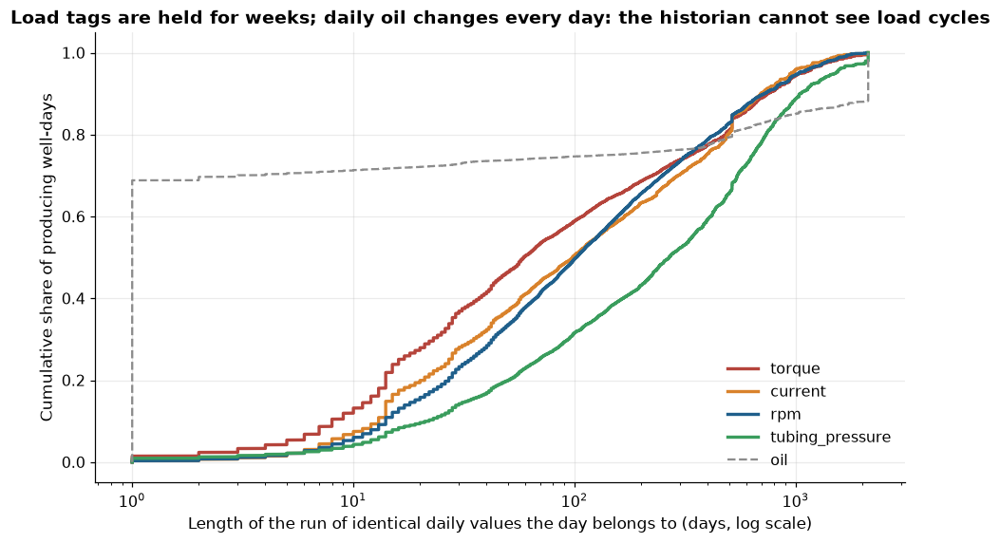
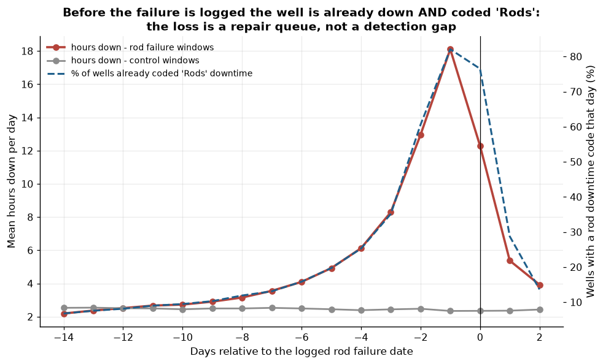
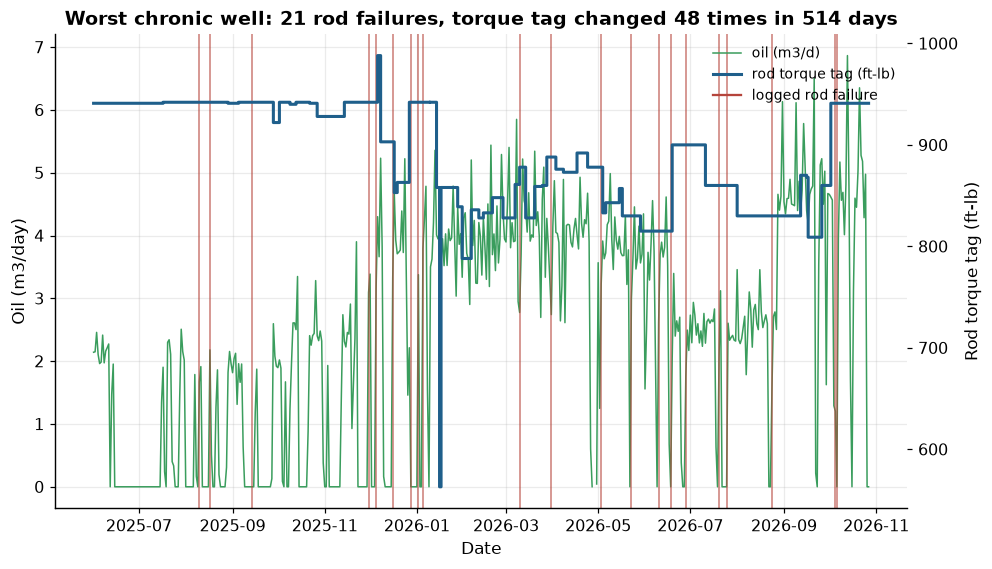
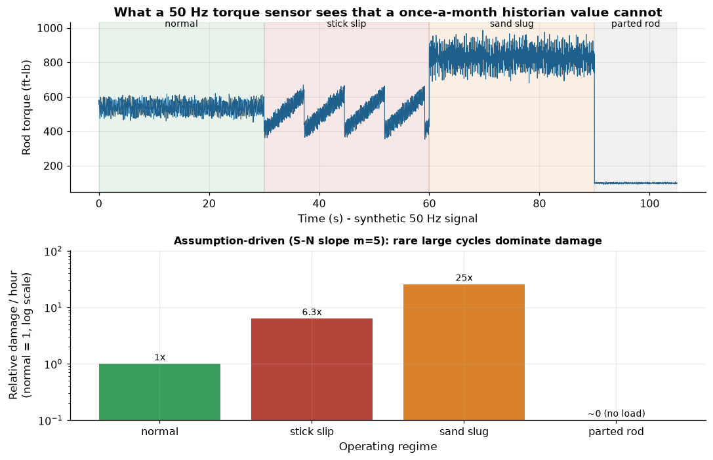
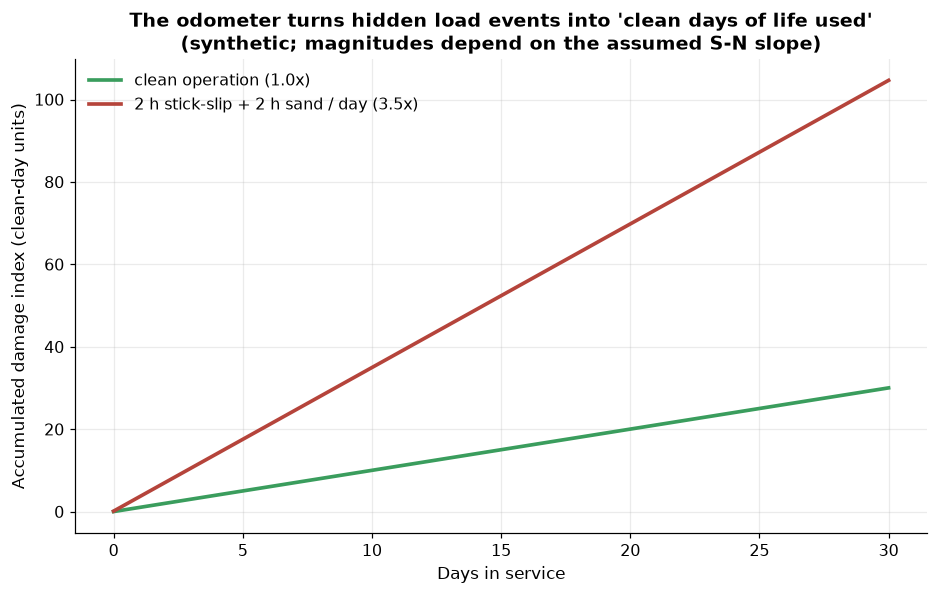

# Idea 4 - Rod-string fatigue odometer: edge AI on an nRF52832, proven on a 3D-printed test rig, streamed into Canary

**New to this? Start with the beginner [build guide](guide.md).** It explains the words, what Canary is, the 3D-printed rig ([STL files](cad/)), the diagrams and a plan for four people.

Complements Idea 1.
Idea 1 says *which* wells should get a new string (3 or more repairs a year).
Idea 4 says *when* a string has used up its life, before the next break, and makes the hidden load history visible.

Scripts:
- `python data/ideas/4/edge_gap_analysis.py` (about 12 s): what the current data cannot see, from real data. Output in `data/ideas/4/out/gap_results.txt`.
- `python data/ideas/4/fatigue_odometer.py` (about 10 s): reference implementation of the on-device algorithm, tested on **synthetic** signals. Output in `data/ideas/4/out/odometer_results.txt`.

## a. Problem

Rod failures are fatigue and corrosion-fatigue failures (Fatigue 1,074, Corrosion 719, Load / Excess Stress 242 of 2,186 rod failures; profile script).
Fatigue damage comes from **load cycles**, but the dataset contains no load cycles.

- **The load tags are held for weeks.**
  For a random producing day, the torque value has been unchanged for a day-weighted median of 59 days.
  The figure is 98 days for motor current, 102 for RPM and 268 for tubing pressure, against 1 day for oil.
  93.2% of torque days sit in runs of 7 or more identical days, and 63.7% in runs of 30 or more.
- **The worst chronic well shows the blind spot.**
  109101004225W300 logged 21 rod failures in 514 days, and its torque tag changed only 48 times (33 distinct values).
- **Sensors add little to prediction today.**
  In Idea 2, sensor trend features each carry about 2% or less of model gain.
- **The pre-failure loss is a repair-queue problem, not a detection gap.**
  We tested the obvious pitch, "a sensor that detects broken rods faster", and the data rejects it.
  - 1,930 rod-failure windows were compared with 1,792 control windows on the same wells.
  - In the 14 days before the logged failure, failure wells lose 9.72 m3 more oil than controls.
  - Of that, 9.38 m3 is booked **under a rod downtime code**, over about 3 extra rod-coded days.
  - The deficit on days the well was *running* is no larger than in controls (-0.64 m3).
  - On day -1, 82% of failing wells are already down and coded "Rods" (1.4% of controls).

So operators already know the rod is broken. The expensive part is the unplanned wait for a rig, plus the next failure.
The lever is to **plan the pull before the break**, and that needs a measure of consumed fatigue life.

## b. Research question

Can a sub-$100 [unverified estimate] edge device do three things?
1. Count torsional load cycles on a PCP rod string in real time (rainflow + Miner's rule).
2. Classify the operating regime (normal / stick-slip / sand-slug overload / parted rod).
3. Stream only a compact summary (damage index, regime) into Canary Historian.

The goal is a pre-emptive "replace now" trigger for Idea 1's chronic wells.

**Target metrics.**
- **Rig phase:** streaming rainflow equals a batch reference exactly. Regime classifier F1 >= 0.85 on held-out *rig* recordings. RAM use under 10% of 64 KB.
- **Pilot phase:** the fraction of chronic-well rod failures preceded by a damage-threshold alarm at least 7 days ahead.

## c. Evidence

**Real data: the historian cannot see load cycles.**

**Real data: before a failure is logged, the well is already down and coded "Rods".**

**Real data: the worst chronic well, 21 failures under an almost flat torque tag.**

**Real data: does a load-exposure feature help Idea 2's risk model? No.**
The rig cannot produce data for historical wells, so we tested its core idea on the daily data instead: fatigue grows with the load a rod string has carried since its last replacement or repair.
We added cumulative rod revolutions (rpm x hours on production x 60) and a torque-weighted damage sum (torque^5, assumed slope) since the last failure job and the last string replacement.
Same time split, same LightGBM settings, 5 seeds, test Jun 2025 to Sep 2026 (script `data/ideas/4/exposure_features.py`, about 7 minutes):

| Variant (failure-log label) | PR-AUC | Precision@50 per week |
|---|---|---|
| Idea 2 baseline | 0.3085 | 0.396 |
| + cumulative revolutions | 0.3090 | 0.399 |
| + revolutions and torque-weighted damage | 0.3081 | 0.397 |

The differences are smaller than the spread between seeds (PR-AUC standard deviation about 0.001, per-seed differences between -0.003 and +0.002), so there is no measurable lift.
Two likely reasons, neither proven:
- Revolutions mostly grow with time, and the model already has failure counts and days since the last failure.
- The torque tag is held for weeks, so the torque weighting carries almost no new information.

This fits the argument of this idea: the daily data cannot see load cycles, so a load-based feature cannot help.
It does not prove that a high-rate load signal would help.
Only a pilot with real high-rate torque and real failure dates can show that.

**Synthetic test of the on-device algorithm.**
Mean torque 625 ft-lb and 200 RPM are the dataset medians. Every regime shape and amplitude is an assumption, drawn at random per window so regimes overlap.

- **Streaming 4-point rainflow vs batch ASTM E1049 3-point rainflow** on the same 600 s, 50 Hz signals: identical cycle counts (1,720.5 / 7,542 / 5,398.5) and identical damage (0.0% difference). There were no stack overflows with a 64-entry stack.
- **Regime classifier** (decision tree, depth 4, 6 window features): 87.1% accuracy on 480 held-out synthetic 10 s windows.
  - Parted rod: F1 1.00
  - Sand slug: F1 0.857
  - Normal: F1 0.826
  - Stick-slip: F1 0.802
  - The main confusion is mild stick-slip vs normal.
  - This only proves the pipeline. Real accuracy must come from rig and field recordings.
- **Device budget:**
  - 2,484 bytes of working RAM (3.8% of the nRF52832's 64 KB): rainflow stack 256 B, damage histogram 1,024 B, 10 s window 1,000 B, tree 204 B.
  - Summaries of 20 B/min instead of 6,000 B/min of raw 50 Hz data, a 300x radio reduction.
- **Relative damage rates** under an assumed S-N slope of m = 5: stick-slip 6.3x normal, sand slug 25x normal.
  A day with 2 h of each counts as 3.48 clean days.
  These magnitudes are **assumption-driven**. The robust point is qualitative: with m around 5, rare large cycles dominate damage.

## d. Domain research

- **PCP rod loading.**
  The string carries axial load and torque together. Fatigue matters most where the rotating string is bent, for example in deviated wells.
  Sources: [PetroWiki, Rod and tubing design for PCP](https://petrowiki.spe.org/Rod_and_tubing_design_for_PCP_systems), [C-FER drive-string fatigue](https://www.cfertech.com/?p=6841).
  The C-FER work notes that lab fatigue tests may not reflect field behaviour once constant torsional and axial stresses are added to cyclic bending.
- **Surface torque is the right signal.**
  - A patent on PCP stick-slip estimates it from motor current and voltage, which track motor torque and speed ([US 7645124](https://image-ppubs.uspto.gov/dirsearch-public/print/downloadPdf/7645124)).
  - Another uses rod-torque thresholds to detect sand and slow the pump ([CIPO 2639450](https://brevets-patents.ic.gc.ca/opic-cipo/cpd/eng/patent/2639450/summary.html)).
  - Weatherford's WellPilot PCP drive already offers torque limits and low-torque detection for rod breaks (vendor brochure, [Weatherford](https://www.weatherford.com/documents/brochure/products-and-services/production-optimization/wellpilot-variable-speed-drive-for-progressing-cavity-pumping)).
  - Many drives therefore already *measure* torque at high rate. The gap is that only one value per day reaches the historian (chart 4a).
  - All read via search summaries.
- **Rainflow + Miner on a microcontroller is established practice.**
  - Bettini and Concari (IEEE ECCE 2020) implement rainflow and Miner's rule on embedded hardware for online predictive maintenance ([CORE](https://core.ac.uk/works/134487378)).
  - Online variants avoid needing the whole stress history ([Antonopoulos et al., NTNU](https://ntnuopen.ntnu.no/ntnu-xmlui/bitstream/11250/2599795/2/Antonopoulos2019cas.pdf)).
  - Both read via search summaries.
  - We use the 4-point streaming form with a bounded stack and verify it against the batch ASTM algorithm.
- **Motor current signature analysis (MCSA)** is a recognised low-cost way to monitor pump condition.
  Deep models are usually too large for microcontrollers, which is why we use a small tree on engineered features.
  Sources: [Alabied thesis, Huddersfield](https://eprints.hud.ac.uk/id/eprint/35263/1/FINAL%20THESIS%20-%20Alabied.pdf), [US 7099852](https://image-ppubs.uspto.gov/dirsearch-public/print/downloadPdf/7099852), both via search summaries.
- **The nRF52832** has a 64 MHz Cortex-M4F with FPU, 512 KB flash, 64 KB RAM, a 12-bit 200 ksps ADC and BLE ([Nordic product brief](https://www.nordicsemi.com/-/media/Software-and-other-downloads/Product-Briefs/nRF52832-product-brief.pdf), [product page](https://www.nordicsemi.com/Products/nRF52832)).
  Nordic's Edge AI add-on targets Cortex-M4F devices, and Edge Impulse exports a portable C++ library ([Nordic Edge Impulse docs](https://nrfconnectdocs.nordicsemi.com/addons/addon-edge-ai/latest/quick_start/edge_impulse.html)). The 52832 is not named explicitly [unverified fit; our tree and rainflow need no ML runtime].
- **DC motor physics for the rig.**
  Torque is proportional to armature current, so a current shunt is a torque sensor for the demo.
  Glycerin or corn syrup gives a viscous, heavy-oil-like load [domain reasoning].
- **Field reality.**
  Electronics on a wellsite must carry a certification for the area classification, for example CSA C22.2 No. 213 for Class I Division 2 ([CSA](https://www.csagroup.org/store/product/2425511/)).
  The rig device is a **prototype of the logic**, not field hardware.
  The production path is the same algorithm in the PCP drive or RTU, writing to Canary.

## e. Proposed solution

**Form:** AI/ML prototype (edge ML + historian integration), plus a physical demonstrator.

**Physical rig (about 1/1000 scale, tabletop).**

| Part | Source | Role |
|---|---|---|
| DC motor + L293D driver | Elegoo UNO R3 Super Starter Kit ([kit listing](https://us.elegoo.com/products/elegoo-uno-r3-super-starter-kit); exact contents vary by version) | "Surface drive" |
| Arduino UNO R3 + LCD1602 + SG90 servo | Same kit | Drive controller. Replays a real well's RPM profile from the dataset, scaled. Servo presses a brake pad to inject stick-slip and sand-slug events. LCD shows the scenario. |
| 3D-printed coupling, long slender shaft adapter, paddle rotor, cup lid, brake pad | Your printer / UCalgary Lab NEXT or Schulich Makerspace ([Lab NEXT](https://library.ucalgary.ca/makerspace/), [Schulich](https://schulich.ucalgary.ca/departments-centres/makerspace)) | "Rod string" and "downhole pump". A magnetic or press-fit coupling pulls apart to simulate a parted rod. |
| Paddle in a cup of glycerin or corn syrup | Grocery store | Viscous heavy-oil analog load |
| Shunt resistor (about 0.1-0.5 ohm) in the motor supply, optional INA219 | Kit resistors / makerspace electronics lab [availability unverified] | Torque proxy (current) |
| nRF52832 board | Yours | Samples current at 50 Hz+, runs streaming rainflow + Miner damage + regime tree, sends a 20 B summary every minute (and on regime change) over BLE |
| Laptop gateway | Python `bleak` | BLE -> Canary Write API through Store and Forward ([Canary Write API v26](https://helpcenter.canarylabs.com/t/g9ypl98/using-the-write-api-version-26); community Python client [birdsong](https://pypi.org/project/birdsong/)) |

**Software and Canary.**
- **Tags:** `Rig.Torque_mean`, `Rig.Torque_p2p`, `Rig.DamageIndex`, `Rig.Regime`, `Rig.DamageRate`.
- **Calcs & Events:**
  - "Stick-slip for 10 or more min"
  - "Damage rate > 3x clean"
  - "Damage index > replacement budget"
  - "Parted rod" (fires in seconds)
  - All are condition-based events with a minimum duration ([Calcs & Events 301](https://helpcenter.canarylabs.com/t/p8h5hl9/calcs-events-301)).
- **Axiom board:** a live rig panel next to Idea 1's chronic-well list. Each well shows its repairs in the last 365 d, all-in cost, and (for instrumented wells) the damage index and regime history.

**What the operator does.**
- Stick-slip or sand alarm: slow the drive, flush, or check fluid level.
- Damage index past budget on a chronic well: schedule the Idea 1 string replacement as a **planned** pull before the break, which removes the unplanned rig wait.
- Parted-rod event: the rod truck is called immediately (a small gain; see section a).

## f. Validation plan

1. **Algorithm correctness (done):** streaming vs batch rainflow on identical signals. Counts and damage match exactly.
2. **Rig validation (time-split, not random):**
   - Record 3 sessions of each regime on the rig.
   - Train the tree on sessions 1-2 and test on session 3, recorded later with re-mounted parts. This is a time-ordered split, so no window from the test session is seen in training.
   - Baseline: a fixed threshold on current std, the rule a drive's low/high-torque alarm uses.
   - Metric: per-class F1 and alarm latency.
3. **Field pilot (proposed):**
   - Pull high-rate torque from the VFDs of 20 chronic wells.
   - Freeze thresholds on month 1, then measure on months 2-6 the share of rod failures preceded by a damage alarm at least 7 days earlier, and the false-alarm rate per well-month.
   - Baseline: Idea 1's count rule.
   - Leakage control: thresholds are fixed before the evaluation period, and failures are taken from the failure log, not from device alarms.
4. **Confounders:** wells instrumented first will be the worst wells, so compare against matched un-instrumented chronic wells (difference-in-differences on rod repairs per producing year).

## g. Business impact (CAD)

Price: $438.5/m3 field-gate (WCS $57.25 USD/bbl x 1.4325 x 6.2898, less 15% [assumption]; see Idea 1).

- **Planned instead of unplanned pull.**
  - The excess rod-coded loss before a failure is 9.38 m3 per failure (script).
  - If a damage-triggered planned pull removes that wait [assumption], each converted failure saves 9.38 x $438.5 = **$4,113** of oil.
- **Pre-emptive replacement on Idea 1's chronic wells.**
  - Idea 1 replaces at the *next* failure, so each well still suffers one more failure ($13,812 all-in).
  - If the odometer triggers the replacement before that failure on 50% of the 145 program wells [assumption]: 145 x 0.5 x $13,812 = **$1.00M** one-off.
- **Costs.**
  - Prototype bill of materials is under about CAD $150 [unverified estimate].
  - In the field, where PCP drives already measure torque, the cost is firmware/RTU logic plus a higher-resolution historian feed. Hardware retrofit cost per certified device is [unverified].
- **Honest framing.**
  The CAD value rests on assumptions that the pilot must test.
  The defensible value now is (1) the physical demonstration of why the data cannot predict fatigue failures and (2) a validated, tiny algorithm that turns high-rate torque into a replacement trigger.

## h. Limitations and risks

- **The classifier results and damage ratios are synthetic.** They prove the pipeline, not field performance. Present them that way.
- **Absolute fatigue life** needs rod-grade S-N data, the corrosion knock-down (Idea 5 shows corrosion evidence on some fatigue-coded breaks) and axial plus bending loads. The odometer gives a *relative* index until it is calibrated against failures.
- **Surface torque misses downhole bending and contact.** Calibration against break history (Idea 5 break depths) is needed.
- **Hazardous-area certification and cybersecurity** apply to any field device. The prototype is not deployable.
- **Build risk is high.** Firmware, rig, BLE and Canary must all work by Sunday noon.
- **Board and toolchain (confirmed: Nordic nRF52 DK, PCA10040, plus a bare nRF52832 module).**
  - Build with the nRF Connect SDK (Zephyr) for board target `nrf52dk/nrf52832`. It has 64 KiB RAM and 512 KiB flash ([nRF Connect SDK board docs](https://developer.nordicsemi.com/nRF_Connect_SDK/doc/2.1.3/zephyr/boards/arm/nrf52dk_nrf52832/doc/index.html)).
  - Run the demo on the DK's **onboard** nRF52832. It flashes over USB through the onboard SEGGER J-Link OB, so there is no wiring risk.
  - The bare module is optional. The DK can program it over SWD through Debug out connector P19 (10-pin cable; pin 3 SWD0_SELECT tied to GND) or P20.
  - The external board must run at the DK's voltage (3.0 V from USB), and should ideally be powered separately ([Nordic: programming an external board](https://docs.nordicsemi.com/r/bundle/ug_nrf52832_dk/page/ug/dk/ext_programming_support_p19.html), [nRF52 DK user guide](https://infocenter.nordicsemi.com/pdf/nRF52_DK_User_Guide_v3.x.x.pdf)).
  - Keep the motor on its own supply with a common ground. The shunt voltage is small, so check the SAADC gain/reference setting, or add an INA219 from the makerspace.

## i. Canary fit

**Strongest possible fit.** Real-time data from a physical asset goes into Historian, Calcs & Events raise alarms, and Axiom shows them for operator decision support.
This matches all four Canary award criteria (technical depth, design, industry relevance, integration).
Model outputs (damage index, regime) are written back as tags, the "surfacing model outputs" pattern the rubric names.

## j. Build plan (to Sunday 12:00)

**Saturday:**
1. (2 h) Print the coupling, paddle rotor and brake pad. Assemble the motor, shaft and cup.
2. (2 h) Uno sketch: PWM speed profile and servo brake events.
3. (3 h) nRF52832 firmware on the nRF52 DK (nRF Connect SDK, target `nrf52dk/nrf52832`, flashed over USB):
   - start from the Zephyr ADC sample and the Nordic UART Service (NUS) BLE peripheral sample
   - add SAADC current sampling at 50 Hz on a timer
   - port `StreamingRainflow` and `damage()` from the Python reference
   - write the tree as if-else
   - send a 20 B summary per minute over NUS.
   Leave the bare module for later.
4. (2 h) Gateway: `bleak` to Canary Write API. Create tags and 3 events. Axiom board.
5. (1 h) Record rig sessions and retrain the tree on real rig windows.

**Sunday morning:** record a 60-second demo video (normal -> brake stick-slip -> syrup overload -> pull the coupling apart, with Canary alarms firing).

**Cut-downs:**
1. No nRF52832: run the algorithm on the Uno with serial to the laptop (the Uno has 2 KB RAM, so shrink the histogram).
2. No hardware: stream synthetic or recorded signals from Python into Canary.
3. No Canary: show a Matplotlib live plot.

## k. Rubric self-score

| Criterion (weight) | Score | Why |
|---|---|---|
| Research depth and domain (25%) | 4 | Fatigue mechanics (rainflow, Miner, Goodman, S-N), PCP torque surveillance, MCSA, hazardous-area realism. |
| Technical implementation (25%) | 4 | Verified streaming algorithm, memory and radio budget, end-to-end hardware path. Classifier is synthetic so far. |
| Insight and business impact (20%) | 2 | Strong diagnostic insight (repair queue, not detection gap), but the CAD value is assumption-based. |
| Presentation (15%) | 5 | A live physical demo with alarms firing in Canary is memorable. |
| Creativity (15%) | 5 | Few teams will bring hardware. It is grounded in a real data gap. |
| **Weighted** | **3.90** | 0.25x4 + 0.25x4 + 0.20x2 + 0.15x5 + 0.15x5 |
