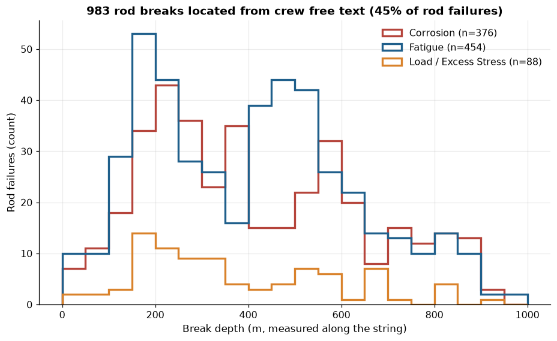
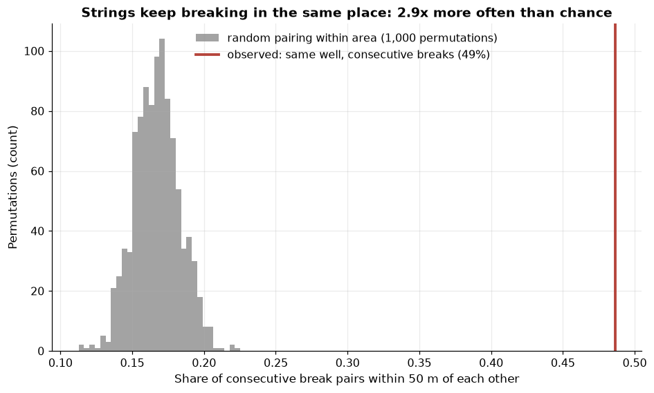
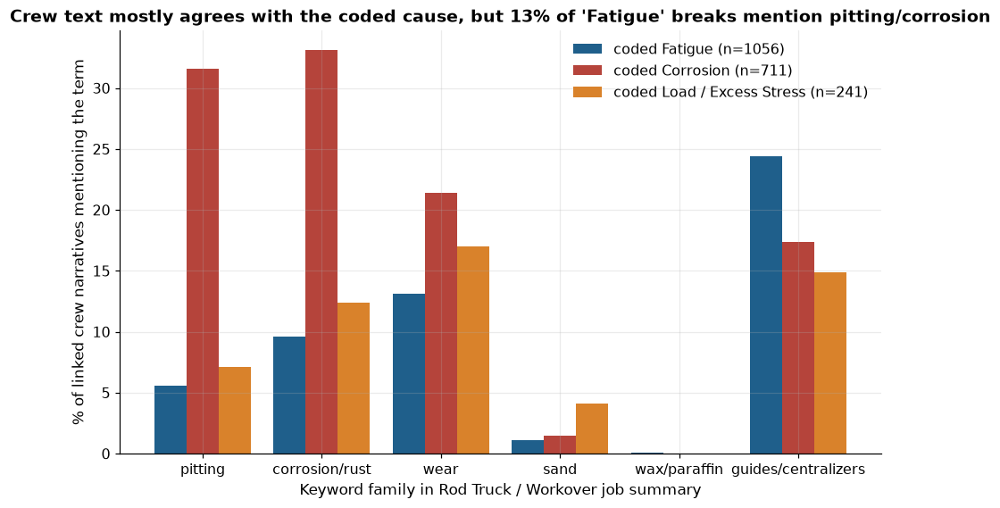
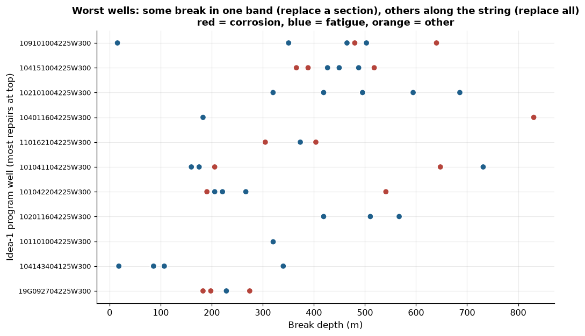

# Idea 5 - Where do strings break? Mining crew narratives to target the fix

Complements Idea 1.
Idea 1 decides *which* wells get a new string.
Idea 5 uses the crews' own words to decide *how much* string to replace and *which remedy* (inhibitor, guides, rod grade) to specify.

Script: `python data/ideas/5/break_depth_mining.py` (about 25 s, mostly a 1,000-draw permutation test).
Output: `data/ideas/5/out/results.txt`, plus a per-failure table `data/ideas/5/out/located_breaks.csv`.

## a. Problem

- Idea 1's chronic wells cost $8.97M a year all-in, and the proposed fix is a full new string at $22,683 on average.
- The structured fields cannot say where the string breaks, so nobody can tell whether a full string is needed or a 100 m section would do.
- They also miss physical evidence: `cause_detail` is 65.72% null and `cause_comments` 99.97% null (profile).
- But the crews write it down.
  - 1,067 of 2,186 rod failures have a `failure_comments` note ("Broken corod @ 247m", "Broken stick rod 48th").
  - 2,153 have a linked Rod Truck or Workover job summary, often in a fixed template: "Pulled to broken corod @ 252m due to pitting. Rod above looks good."
- That text is unused.

## b. Research question

Can break depth and crew-observed cause be extracted reliably from free text?
And do breaks on the same well repeat at the same depth more often than chance?

**Target metrics:**
- share of rod failures located
- share of consecutive same-well breaks within 50 m, against a permutation baseline
- agreement between crew-stated cause and coded cause.

## c. Evidence

**Extraction coverage.**
983 of 2,186 rod failures (45.0%) were located on 412 wells:
- 500 from explicit metres in the failure comment
- 251 from joint/rod number x 7.62 m on stick rods (25 ft API rods)
- 232 from the job summary, which requires a break word plus a metre unit, because summaries are full of pull weights like "free at 15,000lbs" that a naive pattern mistakes for depths.

A random sample of 15 parsed rows is printed in the results file for a manual check.

Median located depth is 366 m for Corrosion, 413 m for Fatigue and 304 m for Load / Excess Stress.

**Breaks repeat at the same depth.**
- There are 510 pairs of consecutive located breaks on 230 wells, at least 7 days apart (median 68 days, so these are not duplicate records).
- 48.6% are within 50 m of the previous break and 62.2% within 100 m. The median gap is 58 m.
- Baseline: pair each break with a random break from another well in the same area. Over 1,000 permutations the share within 50 m averages 16.7%, with a 95th percentile of 19.4%.
- That is **2.9x chance** (permutation p = 0.001, the smallest possible with 1,000 draws).

**Crew text vs coded cause.**
- Crews mention pitting in 31.6% of linked narratives for Corrosion-coded breaks, against 5.6% for Fatigue-coded ones. The codes mostly agree with the field evidence.
- But 139 of 1,056 Fatigue-coded rod failures (13.2%) have a narrative mentioning pitting or corrosion.
- Where the crew states a cause explicitly ("... due to X"):
  - 164 of 186 Corrosion-coded failures say pitting or corrosion.
  - 17 of 66 Fatigue-coded failures say pitting or corrosion.
- Corrosion-fatigue, where fatigue cracks start at corrosion pits, is the likely mechanism behind these mixed signals. It changes the remedy (inhibitor rather than only rod size or guides).

**Idea 1's program wells.**
- 126 of the 145 have at least one located break, and 101 have two or more.
- For those 101, the band between the shallowest and deepest break has a median of 130 m.
- **53.5% (54 wells) break within a band of 150 m or less**, where a section replacement may do.
- 31 program wells have Fatigue-coded failures whose crew narrative mentions pitting or corrosion (13.3% of their 392 linked Fatigue-coded failures).

## d. Domain research

- **Rod geometry.**
  API 11B rods are 25 or 30 ft long, with 25 ft the most common.
  Pony rods come in 6 lengths from 20 to 140 in ([PetroWiki, Sucker rods](https://petrowiki.spe.org/Sucker_rods), via search summary).
  We use 7.62 m per joint and count joints from surface [assumption; ponies at the top add a small offset].
- **Why breaks repeat at one depth.**
  - Rod-on-tubing contact and bending concentrate at doglegs in deviated wells. Rod stress also rises sharply with a smaller rod diameter (PetroWiki notes that a 20% smaller diameter can double rod stress; [PetroWiki, Rod and tubing design for PCP](https://petrowiki.spe.org/Rod_and_tubing_design_for_PCP_systems), via search summary).
  - A location that breaks once stays the weak point if only the broken piece is replaced.
  - This is the engineering basis for section replacement and for placing rod guides or centralisers at that depth.
- **Corrosion fatigue.**
  Pits concentrate stress and start fatigue cracks well below the plain-steel endurance limit.
  Weatherford reports a heavy-oil continuous-rod well going from a 3-month to a 7-year-plus run life after a rod grade change plus an inhibition program (vendor case, [Weatherford](https://www.weatherford.com/documents/real-result/production/artificial-lift-systems/effective-inhibition-program-provides-significant-increase-in-corod-continuous-rod-run-life-in-high)).
- **Technical language processing (TLP).**
  - Maintenance text is described as a largely untapped resource. Abbreviations and misspellings defeat generic NLP, so human-in-the-loop, domain-specific extraction is recommended ([J. Intelligent Manufacturing 2024](https://rd.springer.com/article/10.1007/s10845-024-02323-4)).
  - FMEA-informed named-entity extraction from work orders reports high precision and recall ([MDPI MAKE 2025](https://mdpi.com/2504-4990/7/2/42)).
  - Both via search summaries.
  - Our rule-based extractor is the transparent first step. An LLM or NER pass could raise coverage beyond 45%.

## e. Proposed solution

**Form:** implementation plan with a decision tool. This extends Idea 1's ranked list.

For each program well, the tool adds:
- a break-depth strip (every located break, coloured by cause)
- a band width and a recommendation:
  - Band of 150 m or less: replace that section (corod section splice or replace those stick joints) and add guides at that depth.
  - Wider band: full string.
  - Corrosion evidence in the narratives (coded or crew-stated): add a batch inhibitor program and a corrosion-resistant grade.
- the three crew quotes that support the recommendation, so the engineer can check them.

**Architecture.**
1. Nightly: parse new `failure_comments` and linked job summaries.
2. Write located breaks to a table, with depth, source and confidence.
3. Join to Idea 1's program list.

**Optional LLM pass** to lift coverage (structured extraction of depth, component, crew cause and observations, validated against the regex labels on the 983 located rows).
**Data-use caution:** the datathon terms restrict distributing the dataset (Briefing Document, Privacy & Terms #2). Sending crew text to a third-party API should be cleared with the organisers first. A locally run model avoids the issue.

## f. Validation plan

- **Extraction accuracy:**
  - Hand-label 150 random narratives (3 people, 50 each), stratified across sources.
  - Report precision and recall for depth within 10 m and for crew cause.
  - Baseline: the structured fields alone (0% depth coverage).
- **Repeat-depth effect:** done with a permutation test. Next, repeat it by time split (pairs from 2025 vs 2026) and by area, to show it is stable and not one area.
- **Remedy effect (prospective):**
  - Section replacement vs full replacement, using run-life to next rod repair with the same Cox setup as Idea 1.
  - Stratify by band width and require breaks recorded *before* the job (no future depths), to avoid leakage.
- **Confounders:** crews may write depths more often on certain well types (corod vs stick), so we report coverage by area and rod type.

## g. Business impact (CAD)

Price and Idea 1 unit costs as in Idea 1 (incremental replacement cost $14,010).

- **Section instead of full replacement.**
  - On the 54 program wells breaking within 150 m, assume a section job cuts the incremental cost by 40% [assumption: material scales with length and rig time does not].
  - Savings = 54 x 0.40 x $14,010 = **$0.30M**.
  - Idea 1's break-even on those wells falls from 1.0 to 0.6 failures/yr (same formula, incremental cost x 0.6).
- **Right remedy.**
  - 31 program wells show corrosion evidence behind fatigue codes. An inhibitor program there is cheap relative to a $13,812 failure.
  - The benefit is not quantified from this data. The vendor case above is anecdotal.
- **Main value:** it makes Idea 1 credible to a field audience ("we know where and why it breaks on each well") and lowers its cost.

## h. Limitations and risks

- **45% coverage.** Located failures may not be representative. Stick-rod joint counts assume counting from surface and ignore ponies.
- **Regex extraction** misses free-form phrasing. Precision is checked only by a 15-row sample so far.
- **Narrative vs code** comparisons rely on crews writing "due to X". Only 338 rod failures have that phrase.
- **The 40% section-cost saving is an assumption.** Strathcona's split between rig time and material cost would replace it.
- **Measured vs true vertical depth** is unknown. Depths are along the string.

## i. Canary fit

**Weak fit.**
Break depth is event and text data, not a time series.
It could be stored as an event tag per well and shown on Idea 4's Axiom board, but Canary is not core to this idea.

## j. Build plan (to Sunday 12:00)

- **Done:** extractor, coverage, permutation test, cause comparison, 4 charts and the per-failure CSV.
- **Saturday evening:**
  1. Hand-label 150 rows for precision and recall.
  2. Add the depth strip and recommendation to Idea 1's well cards.
- **Optional:** a local NER or LLM pass on summaries without a depth.
- **Cut-down:** present charts 5b and 5d as the "where it breaks" slide inside the Idea 1 story.

## k. Rubric self-score

| Criterion (weight) | Score | Why |
|---|---|---|
| Research depth and domain (25%) | 4 | Corrosion fatigue, rod geometry, dogleg contact and TLP literature, tied to a measured effect. |
| Technical implementation (25%) | 4 | Careful extraction (the pull-weight trap caught), permutation test, reproducible. |
| Insight and business impact (20%) | 3 | Strong insight (2.9x repeat depth), modest and assumption-based CAD. |
| Presentation (15%) | 4 | "The crews already told us where it breaks" is a memorable line, and chart 5d is easy to read. |
| Creativity (15%) | 5 | Nobody else will read the crew narratives. |
| **Weighted** | **3.95** | 0.25x4 + 0.25x4 + 0.20x3 + 0.15x4 + 0.15x5 |
